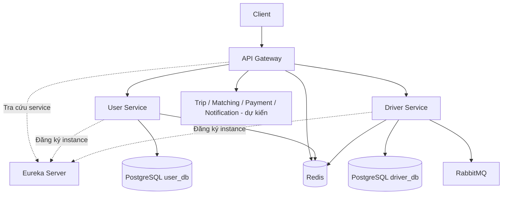

# Ride-Hailing Microservice

Dự án mô phỏng hệ thống gọi xe theo kiến trúc microservice, phục vụ học phần **Các hệ thống phân tán**. Hệ thống hướng đến luồng hành khách đặt chuyến, tìm tài xế gần vị trí đón, giữ tài xế, thực hiện chuyến đi, thanh toán và gửi thông báo.

Repository hiện triển khai quản lý người dùng, xác thực và quản lý tài xế cùng hạ tầng Gateway, service discovery, database, cache và message broker. Các service Trip, Matching, Payment và Notification là phần mở rộng, đã có cấu hình route tại Gateway và database tùy chọn trong Docker Compose.

## Kiến trúc tổng quan



Gateway định tuyến bằng `lb://<SERVICE-NAME>` thông qua Eureka và Spring Cloud LoadBalancer. User và Driver sử dụng database riêng; Driver có thể chạy hai instance để kiểm tra cân bằng tải và xử lý yêu cầu giữ tài xế đồng thời.

## Các thành phần

Các cổng bên dưới là cổng mặc định truy cập từ máy host.

| Thành phần | Cổng | Vai trò / trạng thái |
| --- | --- | --- |
| API Gateway | 8080 | Định tuyến, kiểm tra JWT và blacklist, giới hạn request |
| Eureka Server | 8761 | Service registry và dashboard |
| User Service | 8081 | Đăng ký, đăng nhập, đăng xuất và hồ sơ người dùng |
| Driver Service | 8082 | Hồ sơ, trạng thái, vị trí và giữ/giải phóng tài xế |
| Driver instance 2 | 18082 | Bật bằng profile `scale` |
| Trip Service | 8083 | Dự kiến bổ sung; route `/trips/**` |
| Matching Service | 8084 | Dự kiến bổ sung; route `/matching/**` |
| Payment Service | 8085 | Thanh toán mô phỏng, chống thanh toán trùng (idempotency); route `/payments/**` |
| Notification Service | 8086 | Nhận event và gửi thông báo; route `/notifications/**` |
| PostgreSQL User / Driver | 5433 / 5434 | Database riêng cho hai service hiện có |
| PostgreSQL Trip / Matching / Payment / Notification | 5435–5438 | Database riêng của từng service |
| Redis | 6379 | GEO, JWT blacklist và rate limiting |
| RabbitMQ | 5672 / 15672 | AMQP / giao diện quản trị |

Container kết nối PostgreSQL qua tên service và cổng nội bộ `5432`, ví dụ `user_postgres:5432/user_db`.

## Công nghệ và chức năng chính

- Java 17, Spring Boot 3, Spring Cloud Gateway, Eureka và Gradle Wrapper.
- Spring Data JPA, PostgreSQL và Flyway để quản lý schema theo từng service.
- JWT để xác thực; Redis lưu token bị thu hồi khi đăng xuất cho đến khi hết hạn.
- Redis GEO để tìm tài xế gần vị trí đón theo bán kính.
- Khóa dữ liệu khi giữ tài xế để xử lý cạnh tranh; yêu cầu xung đột trả HTTP `409`.
- RabbitMQ làm hạ tầng trao đổi thông điệp; Docker Compose quản lý môi trường chạy.

ID người dùng, tài xế, chuyến đi (`tripId`) và lượt giữ tài xế (`reservationId`) dùng **UUID**: kiểu `java.util.UUID` trong Java, kiểu `uuid` trong PostgreSQL và chuỗi UUID trong JSON/URL. Ví dụ ID tài xế mẫu: `fd699acc-6544-44a9-9634-5396060c61b8`.

## Cấu trúc repository

```text
api-gateway/       Gateway, JWT filter và cấu hình route
eureka-server/     Service discovery
user-service/      Tài khoản, xác thực và hồ sơ người dùng
driver-service/    Tài xế, vị trí và xử lý giữ tài xế
payment-service/   Thanh toán mô phỏng, idempotency, Saga (phía thanh toán)
notification-service/ Nhận event và gửi thông báo
deploy/            docker-compose.yml dùng chung cho cả hệ thống
docs/              Quy ước code, commit và hợp đồng event (event-schema.md)
tests/             Kiểm thử tích hợp, Redis GEO và tương tranh
scripts/           Seed dữ liệu và kiểm tra cân bằng tải
.env.example       Mẫu cấu hình môi trường
```

Kiểm thử Java của từng module nằm trong `<module>/src/test/java/`.

## Khởi chạy

Yêu cầu: Docker và Docker Compose. Cần JDK 17 để build/chạy kiểm thử Java; Node.js 18 trở lên để chạy các script JavaScript.

### 1. Cấu hình môi trường

Tại thư mục gốc, sao chép file cấu hình mẫu:

```powershell
Copy-Item .env.example .env
```

Trên Linux/macOS dùng `cp .env.example .env`.

**Bắt buộc điền `JWT_SECRET` vào `.env` trước khi chạy Docker Compose.** Giá trị này đang để trống trong `.env.example`; hãy dùng secret ngẫu nhiên ít nhất 64 byte theo hướng dẫn trong file mẫu. Gateway và User Service phải dùng chung secret. `.env` được Git bỏ qua.

### 2. Khởi động hệ thống

File compose nằm trong `deploy/`, nên mọi lệnh chạy từ thư mục gốc phải kèm `-f deploy/docker-compose.yml --env-file .env` (Compose mặc định chỉ tìm `.env` cạnh file compose):

```bash
docker compose -f deploy/docker-compose.yml --env-file .env up --build -d
docker compose -f deploy/docker-compose.yml --env-file .env ps
```

Để gõ ngắn trong một cửa sổ PowerShell, đặt trước hai biến rồi chỉ cần `docker compose up --build -d`, `docker compose ps`...:

```powershell
$env:COMPOSE_FILE = "deploy/docker-compose.yml"
$env:COMPOSE_ENV_FILES = ".env"
```

Các service gọi Eureka qua tên `eureka-server` (gạch ngang), là alias của service `eureka_server`: Tomcat từ chối tên host có dấu gạch dưới với lỗi 400, khiến service không đăng ký được.

Sau khi các container healthy, truy cập Eureka tại `http://localhost:8761` và RabbitMQ Management tại `http://localhost:15672` (mặc định `guest` / `guest`).

Chạy thêm Driver instance thứ hai:

```bash
docker compose -f deploy/docker-compose.yml --env-file .env --profile scale up --build -d
```

Database của cả bảy service đều khởi động mặc định cùng hệ thống.

### 3. Kiểm tra nhanh

```bash
curl http://localhost:8080/ping
curl http://localhost:8080/users/ping
curl http://localhost:8080/drivers/ping
```

Các endpoint trên trả `UP` khi ứng dụng tương ứng hoạt động. Chi tiết kết nối hạ tầng nằm ở `/actuator/health` của từng ứng dụng.

Gateway có các route ping sau; mỗi route chuyển đường dẫn tới service đích thành `/ping` và đứng trước route `/<service>/**` tương ứng:

| Đường dẫn tại Gateway | Service đích |
| --- | --- |
| `/users/ping` | `lb://USER-SERVICE` |
| `/drivers/ping` | `lb://DRIVER-SERVICE` |
| `/trips/ping` | `lb://TRIP-SERVICE` |
| `/matching/ping` | `lb://MATCHING-SERVICE` |
| `/payments/ping` | `lb://PAYMENT-SERVICE` |
| `/notifications/ping` | `lb://NOTIFICATION-SERVICE` |

Bốn route ping mở rộng vẫn qua bộ lọc JWT hiện tại và cần Bearer token hợp lệ. Khi yêu cầu đã qua xác thực nhưng service đích chưa đăng ký Eureka, Gateway trả `503`.

## API chính

Client gọi API qua Gateway tại `http://localhost:8080`.

| Nhóm | Endpoint tiêu biểu |
| --- | --- |
| Xác thực | `POST /auth/register`, `POST /auth/login`, `POST /auth/logout` |
| Hồ sơ | `GET /users/me`, `GET /users/{id}`, `PUT /users/{id}` |
| Tài xế | `GET /drivers/{id}`, `GET /drivers/available?lat=...&lng=...&radius=3` |
| Vị trí | `POST /drivers/{id}/location` |
| Phối hợp nội bộ | `/internal/drivers/{id}/reserve`, `/release`, `/start-trip`, `/complete-trip` |

Đăng ký, đăng nhập và các API GET `/drivers/**` cho phép truy cập công khai. API hồ sơ và các thao tác thay đổi tài xế qua Gateway yêu cầu `Authorization: Bearer <token>`. Tiền tố `/internal/**` bị Gateway chặn từ bên ngoài; các service gọi trực tiếp Driver Service để phối hợp.

Dữ liệu mẫu nằm trong [scripts/seed-data.sql](scripts/seed-data.sql), được nạp khi khởi tạo volume PostgreSQL mới. Có các tài khoản `passenger1@ridehail.com`, `passenger2@ridehail.com` và `driver1@ridehail.com`, cùng mật khẩu `Password@123`.

## Build và kiểm thử

Build toàn bộ sáu module Java, bao gồm kiểm thử và kiểm tra định dạng:

```powershell
.\gradlew.bat build
```

Trên Linux/macOS dùng `sh ./gradlew build`. Có thể chạy riêng `test`, `format` hoặc `checkFormat` bằng Gradle Wrapper. File `gradle.properties` ép Gradle dùng UTF-8 để chú thích tiếng Việt được định dạng giống nhau trên mọi máy.

Sau khi hệ thống Docker hoạt động, chạy kiểm thử tích hợp:

```bash
java tests/VerifyCore.java
```

Script kiểm tra ping, health, cấu hình route, migration, UUID, xác thực, vị trí và luồng giữ tài xế; tự tạo và dọn dữ liệu kiểm thử.

Các kịch bản JavaScript:

```powershell
# JWT lấy từ POST /auth/login, cần cho thao tác cập nhật vị trí
$env:AUTH_TOKEN = '<token>'
node tests/test-redis-geo.js

# Hai kịch bản dưới cần profile scale và hai instance đã đăng ký Eureka
node tests/test-concurrency.js
node scripts/test-load-balancing.js
```

## Tài liệu và vận hành

- [Quy ước code](docs/CODE_STYLE.md)
- [Quy ước commit](docs/COMMIT_CONVENTION.md)
- Xem log: `docker compose -f deploy/docker-compose.yml --env-file .env logs -f api_gateway user_service driver_service_1`.
- Dừng hệ thống: `docker compose -f deploy/docker-compose.yml --env-file .env down`.
- [Hợp đồng event RabbitMQ](docs/event-schema.md)
