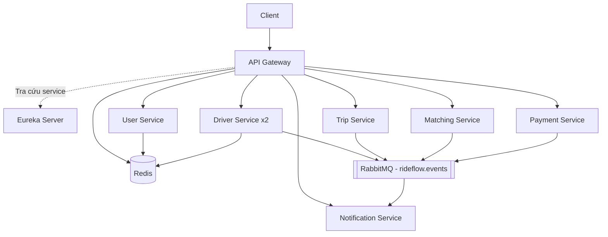

# Ride-Hailing Microservice

Trip/Matching phase3: [báo cáo các mục 4, 8, 13, 10](docs/phase3-trip-matching.md),
[hướng dẫn demo](docs/demo-trip-matching-phase3.md),
[minh chứng kiểm thử](docs/evidence/phase3/trip-matching-results.md).

Dự án mô phỏng hệ thống gọi xe theo kiến trúc microservice, phục vụ học phần **Các hệ thống phân tán**. Hệ thống hướng đến luồng hành khách đặt chuyến, tìm tài xế gần vị trí đón, giữ tài xế, thực hiện chuyến đi, thanh toán và gửi thông báo.

Hệ thống gồm bảy service chạy chung bằng Docker Compose: Eureka Server, API Gateway và sáu service nghiệp vụ (User, Driver, Trip, Matching, Payment, Notification). Mỗi service nghiệp vụ có database PostgreSQL riêng, đăng ký với Eureka và được Gateway định tuyến qua `lb://`. Các service trao đổi sự kiện bất đồng bộ qua RabbitMQ (exchange `rideflow.events`).

Giai đoạn 1 (`v0.1.0`) hoàn thiện khung cho cả bảy service: đăng ký Eureka, route qua Gateway, health check, log JSON có `correlationId` và một file Compose dùng chung. User và Driver đã có nghiệp vụ xác thực, hồ sơ, vị trí và giữ tài xế; Trip, Matching, Payment và Notification hiện có khung service, schema database và kết nối RabbitMQ, nghiệp vụ được bổ sung ở giai đoạn sau.

## Kiến trúc tổng quan



Mỗi service nghiệp vụ dùng một database PostgreSQL riêng (`user_db`, `driver_db`, `trip_db`, `matching_db`, `payment_db`, `notification_db`) và tự đăng ký instance với Eureka.

Gateway định tuyến bằng `lb://<SERVICE-NAME>` thông qua Eureka và Spring Cloud LoadBalancer. Driver có thể chạy hai instance để kiểm tra cân bằng tải và xử lý yêu cầu giữ tài xế đồng thời. Khi một service dừng, service đó hủy đăng ký Eureka và Gateway trả `503` cho tới khi service chạy lại.

Gateway bọc mọi route `lb://` bằng circuit breaker (Resilience4j), mỗi service một breaker dùng chung cho các route của service đó. Một lần gọi bị tính là lỗi khi không kết nối được, không có instance, quá 5s không trả lời, hoặc service trả `500/502/503/504`. Từ 5 lần gọi trở lên trong 10 lần gần nhất mà có ít nhất 50% lỗi thì breaker mở (`OPEN`): Gateway trả `503` ngay kèm JSON `{"service": ..., "circuitState": "OPEN"}` mà không gọi service. Sau 10s breaker tự sang `HALF_OPEN`, cho 3 lần gọi thử; thành công thì đóng lại, còn lỗi thì mở tiếp. Xem trạng thái tại `GET /actuator/circuitbreakers` của Gateway; cấu hình nằm trong `api-gateway/src/main/resources/application.yml` (mục `resilience4j`).

## Các thành phần

Các cổng bên dưới là cổng mặc định truy cập từ máy host.

| Thành phần | Cổng | Công nghệ | Vai trò |
| --- | --- | --- | --- |
| API Gateway | 8080 | Spring Cloud Gateway | Định tuyến, kiểm tra JWT và blacklist, giới hạn request, circuit breaker theo service |
| Eureka Server | 8761 | Spring Cloud Netflix | Service registry và dashboard |
| User Service | 8081 | Spring Boot | Đăng ký, đăng nhập, đăng xuất và hồ sơ người dùng; route `/auth/**`, `/users/**` |
| Driver Service | 8082 | Spring Boot | Hồ sơ, trạng thái, vị trí và giữ/giải phóng tài xế; route `/drivers/**` |
| Driver instance 2 | 18082 | Spring Boot | Bật bằng profile `scale` |
| Trip Service | 8083 | Node.js (Express) | Quản lý chuyến đi và trạng thái chuyến; route `/trips/**` |
| Matching Service | 8084 | Node.js (Express) | Tìm và chọn tài xế cho chuyến; route `/matching/**` |
| Payment Service | 8085 | Spring Boot | Thanh toán mô phỏng, chống thanh toán trùng (idempotency), Saga phía thanh toán; route `/payments/**` |
| Notification Service | 8086 | Spring Boot | Nhận event và gửi thông báo; route `/notifications/**` |
| PostgreSQL User / Driver / Trip | 5433 / 5434 / 5435 | PostgreSQL 16 | Database riêng của từng service |
| PostgreSQL Matching / Payment / Notification | 5436 / 5437 / 5438 | PostgreSQL 16 | Database riêng của từng service |
| Redis | 6379 | GEO, JWT blacklist và rate limiting |
| RabbitMQ | 5672 / 15672 | AMQP / giao diện quản trị |

Container kết nối PostgreSQL qua tên service và cổng nội bộ `5432`, ví dụ `user_postgres:5432/user_db`.

## Công nghệ và chức năng chính

- Java 17, Spring Boot 3, Spring Cloud Gateway, Eureka và Gradle Wrapper cho Gateway, Eureka, User, Driver, Payment và Notification.
- Node.js 22, Express, `pg`, `amqplib` và `eureka-js-client` cho Trip và Matching.
- Spring Data JPA và Flyway quản lý schema của các service Java; Trip và Matching tạo schema bằng file SQL khởi tạo (`trip_db.sql`, `matching_db.sql`).
- JWT để xác thực; Redis lưu token bị thu hồi khi đăng xuất cho đến khi hết hạn.
- Redis GEO để tìm tài xế gần vị trí đón theo bán kính.
- Khóa dữ liệu khi giữ tài xế để xử lý cạnh tranh; yêu cầu xung đột trả HTTP `409`.
- RabbitMQ: topic exchange `rideflow.events`, routing key là loại event; định dạng event và quy tắc idempotency xem [docs/event-schema.md](docs/event-schema.md).
- Mọi request mang header `X-Correlation-ID` (tự sinh nếu thiếu); log của mọi service ở dạng JSON gồm `service`, `instanceId`, `correlationId` để lần theo một request qua nhiều service.
- Docker Compose quản lý toàn bộ môi trường chạy.

ID người dùng, tài xế, chuyến đi (`tripId`) và lượt giữ tài xế (`reservationId`) dùng **UUID**: kiểu `java.util.UUID` trong Java, kiểu `uuid` trong PostgreSQL và chuỗi UUID trong JSON/URL. Ví dụ ID tài xế mẫu: `fd699acc-6544-44a9-9634-5396060c61b8`.

## Cấu trúc repository

```text
api-gateway/       Gateway, JWT filter và cấu hình route
eureka-server/     Service discovery
user-service/      Tài khoản, xác thực và hồ sơ người dùng
driver-service/    Tài xế, vị trí và xử lý giữ tài xế
trip-service/      Chuyến đi (Node.js), schema trong trip_db.sql
matching-service/  Ghép tài xế (Node.js), schema trong matching_db.sql
payment-service/   Thanh toán mô phỏng, idempotency, Saga (phía thanh toán)
notification-service/ Nhận event và gửi thông báo
deploy/            docker-compose.yml dùng chung cho cả hệ thống
docs/              Quy ước code, commit và hợp đồng event (event-schema.md)
tests/             Kiểm thử tích hợp, Redis GEO và tương tranh
scripts/           Seed dữ liệu và kiểm tra cân bằng tải
.env.example       Mẫu cấu hình môi trường
```

Kiểm thử Java của từng module nằm trong `<module>/src/test/java/`. Trip và Matching được build thành image Node.js riêng từ `Dockerfile` trong thư mục service.

## Khởi chạy

Yêu cầu: Docker và Docker Compose. Cần JDK 17 để build/chạy kiểm thử Java; Node.js 18 trở lên để chạy các script JavaScript. Không cần cài Node.js để chạy Trip và Matching vì hai service này build trong Docker.

### 1. Cấu hình môi trường

Tại thư mục gốc, sao chép file cấu hình mẫu:

```powershell
Copy-Item .env.example .env
```

Trên Linux/macOS dùng `cp .env.example .env`.

**Bắt buộc điền `JWT_SECRET` vào `.env` trước khi chạy Docker Compose.** Giá trị này đang để trống trong `.env.example`; hãy dùng secret ngẫu nhiên ít nhất 64 byte theo hướng dẫn trong file mẫu. Gateway và User Service phải dùng chung secret. `.env` được Git bỏ qua.

### 2. Khởi động hệ thống

File compose nằm trong `deploy/`, nên mọi lệnh chạy từ thư mục gốc phải kèm `-f deploy/docker-compose.yml --env-file .env` (Compose mặc định chỉ tìm `.env` cạnh file compose):

```bash
docker compose -f deploy/docker-compose.yml --env-file .env up --build -d
docker compose -f deploy/docker-compose.yml --env-file .env ps
```

Để gõ ngắn trong một cửa sổ PowerShell, đặt trước hai biến rồi chỉ cần `docker compose up --build -d`, `docker compose ps`...:

```powershell
$env:COMPOSE_FILE = "deploy/docker-compose.yml"
$env:COMPOSE_ENV_FILES = ".env"
```

Các service gọi Eureka qua tên `eureka-server` (gạch ngang), là alias của service `eureka_server`: Tomcat từ chối tên host có dấu gạch dưới với lỗi 400, khiến service không đăng ký được.

Sau khi các container healthy, truy cập Eureka tại `http://localhost:8761` và RabbitMQ Management tại `http://localhost:15672` (mặc định `guest` / `guest`).

Chạy thêm Driver instance thứ hai:

```bash
docker compose -f deploy/docker-compose.yml --env-file .env --profile scale up --build -d
```

Database của cả sáu service nghiệp vụ đều khởi động mặc định cùng hệ thống. Khi đủ 17 container healthy (tính cả Driver instance 2), dashboard Eureka hiển thị bảy tên service: `API-GATEWAY`, `USER-SERVICE`, `DRIVER-SERVICE` (2 instance), `TRIP-SERVICE`, `MATCHING-SERVICE`, `PAYMENT-SERVICE`, `NOTIFICATION-SERVICE`.

### 3. Kiểm tra nhanh

```bash
curl http://localhost:8080/ping
curl http://localhost:8080/users/ping
curl http://localhost:8080/drivers/ping
```

Các endpoint trên trả `UP` khi ứng dụng tương ứng hoạt động. Chi tiết kết nối hạ tầng nằm ở `/actuator/health` của các service Java; `/ping` của Trip và Matching kiểm tra cả PostgreSQL và RabbitMQ, trả JSON `{"status":"UP","service":"..."}` hoặc `503` khi một trong hai mất kết nối.

Gateway có các route ping sau; mỗi route chuyển đường dẫn tới service đích thành `/ping` và đứng trước route `/<service>/**` tương ứng:

| Đường dẫn tại Gateway | Service đích |
| --- | --- |
| `/users/ping` | `lb://USER-SERVICE` |
| `/drivers/ping` | `lb://DRIVER-SERVICE` |
| `/trips/ping` | `lb://TRIP-SERVICE` |
| `/matching/ping` | `lb://MATCHING-SERVICE` |
| `/payments/ping` | `lb://PAYMENT-SERVICE` |
| `/notifications/ping` | `lb://NOTIFICATION-SERVICE` |

Bốn route ping mở rộng vẫn qua bộ lọc JWT hiện tại và cần Bearer token hợp lệ. Khi yêu cầu đã qua xác thực nhưng service đích chưa đăng ký Eureka, Gateway trả `503`.

Ví dụ PowerShell lấy token bằng tài khoản mẫu rồi ping cả sáu service:

```powershell
$body = @{ email = "passenger1@ridehail.com"; password = "Password@123" } | ConvertTo-Json
$login = Invoke-RestMethod -Method Post -Uri http://127.0.0.1:8080/auth/login -ContentType "application/json" -Body $body
$h = @{ Authorization = "Bearer $($login.token)"; "X-Correlation-ID" = "demo-1" }
foreach ($p in "users", "drivers", "trips", "matching", "payments", "notifications") {
  "$p : " + (Invoke-WebRequest "http://127.0.0.1:8080/$p/ping" -Headers $h -UseBasicParsing).Content
}
```

Nếu PowerShell báo `Unable to connect to the remote server` trong khi `curl.exe http://127.0.0.1:8080/ping` vẫn chạy, máy đang dùng proxy hệ thống; tắt proxy cho cửa sổ hiện tại bằng `[System.Net.WebRequest]::DefaultWebProxy = New-Object System.Net.WebProxy`.

## API chính

Client gọi API qua Gateway tại `http://localhost:8080`.

| Nhóm | Endpoint tiêu biểu |
| --- | --- |
| Xác thực | `POST /auth/register`, `POST /auth/login`, `POST /auth/logout` |
| Hồ sơ | `GET /users/me`, `PUT /users/me`, `GET /users/{id}`, `PUT /users/{id}` |
| Tài xế | `POST /drivers`, `GET /drivers/me`, `GET /drivers/{id}`, `GET /drivers/available?lat=...&lng=...&radius=3` |
| Vị trí | `POST /drivers/{id}/location` |
| Phối hợp nội bộ | `/internal/users/{id}`, `/internal/drivers/{id}/reserve`, `/release`, `/start-trip`, `/complete-trip` |

Đăng ký, đăng nhập và các API GET `/drivers/**` (trừ `/drivers/me`) cho phép truy cập công khai. API hồ sơ, tạo/xem hồ sơ tài xế của chính mình (`POST /drivers`, `GET /drivers/me`) và các thao tác thay đổi tài xế qua Gateway yêu cầu `Authorization: Bearer <token>`. Tiền tố `/internal/**` bị Gateway chặn từ bên ngoài; các service gọi trực tiếp Driver Service để phối hợp.

Dữ liệu mẫu nằm trong [scripts/seed-data.sql](scripts/seed-data.sql), được nạp khi khởi tạo volume PostgreSQL mới. Có các tài khoản `passenger1@ridehail.com`, `passenger2@ridehail.com` và `driver1@ridehail.com` (khớp chung ID `fd699acc-6544-44a9-9634-5396060c61b8` ở cả `user_db` và `driver_db`), cùng mật khẩu `Password@123`.

## Saga thanh toán và thông báo

Khi chuyến đi hoàn thành, Trip Service publish `trip.completed`. Payment Service thu tiền mô
phỏng (vượt 2.000.000 VND thì thất bại), lưu payment cùng event kết quả vào bảng outbox rồi
publish `payment.succeeded` hoặc `payment.failed`. Thanh toán thất bại thì Trip Service chạy bước
bù trừ và publish `trip.compensated`. Notification Service nhận các event này và gửi thông báo
cho khách và tài xế. Chi tiết luồng và cách xử lý lỗi ở [docs/saga.md](docs/saga.md).

| Cơ chế | Cách làm |
| --- | --- |
| Chống trùng | Bảng `processed_events` theo `eventId`; `UNIQUE(idempotency_key = tripId)` cho payment |
| Retry | Consumer thử lại 3 lần (backoff 1s, 2s) |
| Dead-letter queue | `<queue>.dlq` qua exchange `rideflow.dlx`; xem/replay bằng `/internal/payments/dlq`, `/internal/notifications/dlq` |
| Publish tin cậy | Outbox `outbox_events` + publisher confirm |

API cho người dùng (qua Gateway, cần Bearer token): `GET /payments/me`, `GET /payments/{id}`,
`GET /payments/trips/{tripId}`, `GET /notifications/me`.

Giả lập event và chạy bộ kiểm thử giai đoạn 2 (ghi kết quả vào `docs/evidence/phase2/`):

```powershell
Set-ExecutionPolicy -Scope Process Bypass
.\scripts\publish-event.ps1 -EventType trip.completed -Payload @{ tripId = [guid]::NewGuid().ToString(); riderId = '26a7f8fe-79a8-49ea-a46a-9529e5c3e381'; driverId = 'fd699acc-6544-44a9-9634-5396060c61b8'; fareAmount = 125000 }
.\tests\phase2-payment-notification.ps1
```

## Giám sát: metrics, log tập trung và trace

Nhóm giám sát là tùy chọn, chỉ chạy khi thêm `--profile observability`; không bật thì các service vẫn chạy bình thường. Nhóm này cần thêm khoảng 700 MB RAM cho Docker. Với Docker Desktop dùng WSL 2, giới hạn mặc định là một nửa RAM máy; ở mức 3,5 GB, cả hệ thống kèm nhóm giám sát chạy rất chậm (request có thể quá 5s và làm circuit breaker mở). Nên nâng lên khoảng 5 GB bằng file `%USERPROFILE%\.wslconfig` gồm hai dòng `[wsl2]` và `memory=5GB`, rồi chạy `wsl --shutdown` và mở lại Docker Desktop.

```powershell
docker compose -f deploy/docker-compose.yml --env-file .env --profile observability up --build -d
```

| Công cụ | Địa chỉ | Dùng để |
| --- | --- | --- |
| Grafana | http://localhost:3000 | Dashboard "RideFlow - Giám sát service": instance đang chạy, trạng thái circuit breaker, số request, lỗi 5xx, thời gian xử lý p95, bộ nhớ và log của mọi service. Xem không cần đăng nhập; tài khoản quản trị lấy từ `GRAFANA_ADMIN_USER` / `GRAFANA_ADMIN_PASSWORD` trong `.env` |
| Prometheus | http://localhost:9090 | Thu metrics mỗi 15s. Tự tìm instance qua Eureka nên instance thứ hai của Driver được thêm tự động |
| Loki + Promtail | (xem qua Grafana) | Gom log của mọi container. Tìm theo correlationId bằng ô "Tìm trong log" trên dashboard, hoặc truy vấn `{service=~".+"} \|= "<correlation-id>"` trong Grafana Explore |
| Zipkin | http://localhost:9411 | Xem trace của request đi qua nhiều service; tìm theo tag `correlationId=<correlation-id>` |

- **Metrics:** service Java mở `/actuator/prometheus`; Trip và Matching mở `/metrics` với cùng tên metric `http_server_requests_seconds` nên dùng chung một dashboard.
- **Log:** Promtail đọc log qua Docker socket (chỉ đọc), tách trường `level` của log JSON thành nhãn để lọc.
- **Trace:** năm service Java gửi span sang Zipkin, gồm cả span publish/consume RabbitMQ của Payment và Notification. Trip và Matching (Node.js) chưa gửi span, nên trace bị ngắt ở hai service này; dùng correlationId để nối các đoạn.
- Cấu hình nằm trong `deploy/observability/`.

Kiểm tra trên hệ thống đang chạy:

```powershell
node scripts/check-observability.js
node scripts/check-tracing.js
```

## Build và kiểm thử

Build toàn bộ sáu module Java, bao gồm kiểm thử và kiểm tra định dạng:

```powershell
.\gradlew.bat build
```

Trên Linux/macOS dùng `sh ./gradlew build`. Có thể chạy riêng `test`, `format` hoặc `checkFormat` bằng Gradle Wrapper. File `gradle.properties` ép Gradle dùng UTF-8 để chú thích tiếng Việt được định dạng giống nhau trên mọi máy.

Sau khi hệ thống Docker hoạt động, chạy kiểm thử tích hợp:

```bash
java tests/VerifyCore.java
```

Script kiểm tra ping, health, cấu hình route, migration, UUID, xác thực, vị trí và luồng giữ tài xế; tự tạo và dọn dữ liệu kiểm thử.

Các kịch bản JavaScript:

```powershell
# JWT lấy từ POST /auth/login, cần cho thao tác cập nhật vị trí
$env:AUTH_TOKEN = '<token>'
node tests/test-redis-geo.js

# Hai kịch bản dưới cần profile scale và hai instance đã đăng ký Eureka
node tests/test-concurrency.js
node scripts/test-load-balancing.js

# Tài xế từ chối chuyến -> sẵn sàng ngay -> Matching ghép tài xế khác (cần npm ci trong trip-service)
node scripts/check-driver-reject.js

# Circuit breaker: script tự pause/stop rồi bật lại driver_service_1, chạy khoảng 2-3 phút
node scripts/check-circuit-breaker.js
```

## Tài liệu và vận hành

- [Quy ước code](docs/CODE_STYLE.md)
- [Quy ước commit](docs/COMMIT_CONVENTION.md)
- Xem log: `docker compose -f deploy/docker-compose.yml --env-file .env logs -f api_gateway user_service driver_service_1 trip_service matching_service`.
- Lần theo một request: `docker compose -f deploy/docker-compose.yml --env-file .env logs | Select-String "<correlation-id>"`.
- Dừng hệ thống: `docker compose -f deploy/docker-compose.yml --env-file .env down`.
- [Hợp đồng event RabbitMQ](docs/event-schema.md)
