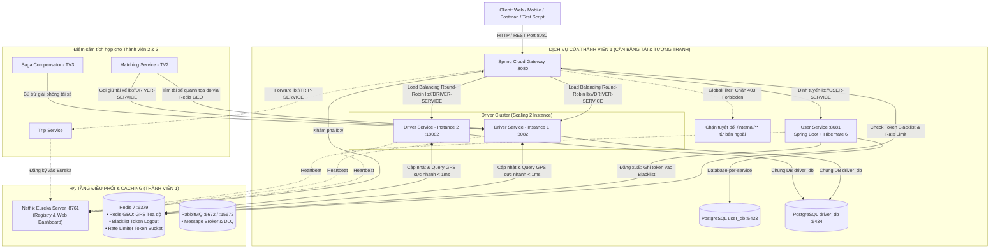
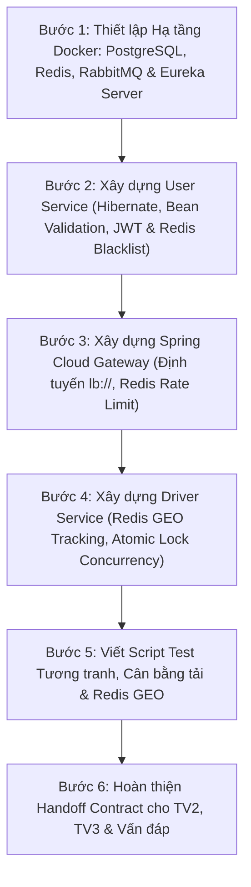

# 🗺️ LỘ TRÌNH TRIỂN KHAI ĐỘC LẬP - THÀNH VIÊN 1

> **Trạng thái kiểm chứng**: tài liệu này mô tả thiết kế và các mốc triển khai.
> Source hiện có Gateway, User, Driver và Eureka; build và 58 kiểm thử Java đã đạt.
> Kiểm thử Docker toàn hệ thống, hiệu năng Redis và tương tranh hai container
> chưa được xác nhận. Xem mục “Trạng thái kiểm chứng” trong README trước khi
> đối chiếu các checklist và số liệu mục tiêu bên dưới.
> Cấu trúc package đang áp dụng được mô tả trong `CODE_STYLE.md`; checkbox chưa
> đánh dấu là tiêu chí cần kiểm chứng runtime, dù source đã được triển khai.

## TÀI KHOẢN, TÀI XẾ VÀ NỀN TẢNG TRIỂN KHAI (INFRASTRUCTURE & CORE SERVICES)
### (Công nghệ: Spring Boot 3 + Hibernate 6 + Gradle Groovy + Netflix Eureka + Redis | CSDL: PostgreSQL | Message Broker: RabbitMQ)

> **Dự án**: Hệ thống Microservices Gọi xe mô phỏng Grab/Uber (Đề tài DS03 - Các hệ thống phân tán)  
> **Người thực hiện**: **Thành viên 1**  
> **Tech Stack chuẩn hóa (Phương án Tối ưu Toàn diện)**:
> - **Ngôn ngữ & Runtime**: Java 17/21, Spring Boot 3.x, Spring Cloud Gateway (Reactive).
> - **Khám phá Dịch vụ (Service Discovery)**: **Netflix Eureka Server** (`:8761`) & **Eureka Client**, điều phối định tuyến động qua `lb://`.
> - **Cân bằng tải (Load Balancing)**: **Spring Cloud LoadBalancer** (Round-Robin, Client-Side Load Balancing), hỗ trợ mở rộng nhiều instance (`docker compose scale`).
> - **Bộ nhớ đệm & Tọa độ Siêu tốc**: **Redis 7 (In-Memory Data Store)**:
>   1. **Redis GEO (`GEOADD`, `GEOSEARCH`)**: Lưu và truy vấn vị trí GPS tài xế trong bán kính cực nhanh ($< 1\text{ms}$), chống nghẽn I/O PostgreSQL.
>   2. **Redis JWT Token Blacklist**: Quản lý thu hồi token khi người dùng Đăng xuất (Logout) hoặc bị Khóa tài khoản.
>   3. **Redis Rate Limiting**: Chống spam, chống tấn công Brute-force/DoS tại API Gateway bằng thuật toán Token Bucket.
> - **Hàng đợi Thông điệp (Message Broker)**: **RabbitMQ** (AMQP `:5672`, Management `:15672`), hỗ trợ Dead-Letter Queue (DLQ), Retry và giao dịch phân tán Saga.
> - **Kiểm tra Trạng thái (Health Check)**: **Spring Boot Actuator** (`/actuator/health`), Eureka Heartbeat Lease Renewal (phát hiện nhanh service Online/Offline).
> - **Công cụ Build**: **Gradle** với **Groovy DSL** (`build.gradle`, `settings.gradle`).
> - **Cơ sở dữ liệu & ORM**: **PostgreSQL** (ACID, Row-Level Locking, Database-per-service), **Hibernate 6** (JPA Provider).
> - **Xác thực dữ liệu (Validation)**: **Jakarta Bean Validation / Hibernate Validator** (`@Valid`, `@NotBlank`, `@Pattern`, `@Size`, `@DecimalMin/Max`), State Transition Guard.
> - **Bảo mật & Token**: Spring Security, JJWT (`io.jsonwebtoken`), `BCryptPasswordEncoder(10)`.
> - **Tracing & Log**: SLF4J, Logback, MDC (Mapped Diagnostic Context), JSON structured log đủ 9 trường.
> - **Đóng gói & Điều phối**: Dockerfile (Multi-stage build bằng Gradle), Docker Compose.

---

## 📑 MỤC LỤC
1. [Sơ đồ Kiến trúc & Tiêu chí hoàn thành (DoD)](#1-sơ-đồ-kiến-trúc--tiêu-chí-hoàn-thành-dod)
2. [Cấu trúc Thư mục Dự án Gradle (Groovy DSL)](#2-cấu-trúc-thư-mục-dự-án-gradle-groovy-dsl)
3. [Lộ trình 6 bước triển khai thực tế](#3-lộ-trình-6-bước-triển-khai-thực-tế)
4. [Đặc tả Kỹ thuật & Cấu hình Gradle / Hibernate / Eureka / Redis chi tiết](#4-đặc-tả-kỹ-thuật--cấu-hình-gradle--hibernate--eureka--redis-chi-tiết)
   - [4.1. Nền tảng Hạ tầng Docker Compose (PostgreSQL, RabbitMQ, Redis, Eureka)](#41-nền-tảng-hạ-tầng-docker-compose-postgresql-rabbitmq-redis-eureka)
   - [4.2. Service Registry & Discovery (Netflix Eureka Server)](#42-service-registry--discovery-netflix-eureka-server)
   - [4.3. API Gateway (Dynamic Routing `lb://`, Redis Rate Limiting & Token Blacklist)](#43-api-gateway-dynamic-routing-lb-redis-rate-limiting--token-blacklist)
   - [4.4. Ứng dụng Redis Tối ưu Hiệu năng (Redis GEO & Token Blacklist)](#44-ứng-dụng-redis-tối-ưu-hiệu-năng-redis-geo--token-blacklist)
   - [4.5. Cơ chế Kiểm tra Trạng thái Dịch vụ & Cân bằng Tải](#45-cơ-chế-kiểm-tra-trạng-thái-dịch-vụ--cân-bằng-tải)
   - [4.6. User Service (Validation DTO, Hibernate Entity, Spring Security & JWT Logout)](#46-user-service-validation-dto-hibernate-entity-spring-security--jwt-logout)
   - [4.7. Driver Service (Validation DTO, Redis GEO Tracking & Atomic Concurrency Lock)](#47-driver-service-validation-dto-redis-geo-tracking--atomic-concurrency-lock)
   - [4.8. Chuẩn hóa Xử lý Lỗi Validation Tập trung (Global Exception Handler)](#48-chuẩn-hóa-xử-lý-lỗi-validation-tập-trung-global-exception-handler)
   - [4.9. Chuẩn hóa Logging & Tracing với SLF4J / MDC (Chuẩn 9 trường)](#49-chuẩn-hóa-logging--tracing-với-slf4j--mdc-chuẩn-9-trường)
5. [Hợp đồng bàn giao API (Handoff Contract) cho TV2 và TV3](#5-hợp-đồng-bàn-giao-api-handoff-contract-cho-tv2-và-tv3)
6. [Kịch bản Kiểm thử Tương tranh, Redis Demo, Chịu lỗi & Vấn đáp](#6-kịch-bản-kiểm-thử-tương-tranh-redis-demo-chịu-lỗi--vấn-đáp)

---

## 1. SƠ ĐỒ KIẾN TRÚC & TIÊU CHÍ HOÀN THÀNH (DoD)

### 1.1. Sơ đồ Kiến trúc Microservices Tối ưu của Thành viên 1


### 1.2. Tiêu chí hoàn thành (Definition of Done - DoD)
- [ ] **Tối ưu hóa Hiệu năng với Redis (High-Performance In-Memory Data Store)**:
  - **Redis GEO**: Lưu và truy vấn vị trí tài xế theo tọa độ kinh/vĩ độ thời gian thực (`GEOADD`, `GEOSEARCH`) với độ trễ dưới 1 mili-giây, giải phóng gánh nặng I/O cho PostgreSQL.
  - **JWT Token Revocation (Blacklist)**: Cho phép hành khách và tài xế Đăng xuất (Logout) an toàn. Token đã logout bị đưa vào Redis với TTL tự hủy, Gateway chặn ngay request tiếp theo với mã `401 Unauthorized`.
  - **Rate Limiting tại Gateway**: Giới hạn tần suất gọi API (10 req/s, burst 20) qua Redis Token Bucket để ngăn ngừa tấn công DoS và Brute-force.
- [ ] **Service Discovery & Registry (Ăn trọn điểm Mục 7.5 & 4.2 trong PDF)**:
  - Khởi chạy `Eureka Server` (Port 8761) cung cấp Web Dashboard theo dõi các service theo thời gian thực.
  - Gateway định tuyến động qua tiền tố Load-Balanced `lb://USER-SERVICE`, `lb://DRIVER-SERVICE`.
- [ ] **Cân bằng Tải (Client-Side Load Balancing)**:
  - Áp dụng `Spring Cloud LoadBalancer` với thuật toán **Round-Robin** luân phiên điều phối request giữa `driver_service_1` và `driver_service_2`.
  - Header phản hồi `X-Handled-By-Instance` chứng minh tải chia đều 50/50.
- [ ] **Kiểm tra Trạng thái Dịch vụ (Health Check & Liveness Probe)**:
  - Tích hợp `Spring Boot Actuator` trên mọi service (`/actuator/health`). Giám sát kết nối PostgreSQL, Redis và dung lượng đĩa.
  - Cấu hình Eureka Heartbeat Lease Renewal giúp loại bỏ node chết trong 10 giây.
- [x] **Xác thực dữ liệu đầu vào (Input Validation & Sanitization)**:
  - DTO được kiểm tra bằng `Jakarta Bean Validation` (`@Valid`, `@NotBlank`, `@Email`, `@Pattern`, `@Size`, `@DecimalMin/Max`).
  - Giới hạn Payload tối đa tại Gateway $\le 2\text{MB}$. Validation định dạng `X-Correlation-ID`.
- [ ] **Kiểm soát Tương tranh Đa Instance (Distributed Concurrency Control)**:
  - Dù request đến bất kỳ instance nào của Driver Service, **Row-Level Lock của PostgreSQL** vẫn đảm bảo chỉ 1 request thành công (`200 OK`), request còn lại nhận **`409 Conflict`**.

---

## 2. CẤU TRÚC THƯ MỤC DỰ ÁN GRADLE (GROOVY DSL)

```text
ride-hailing-microservice/
├── eureka-server/                          # [Thành viên 1] Netflix Eureka Registry & Dashboard (:8761)
│   ├── src/main/java/com/ridehail/eureka/
│   │   └── EurekaServerApplication.java    # @EnableEurekaServer
│   ├── src/main/resources/
│   │   └── application.yml
│   ├── Dockerfile
│   ├── build.gradle                        # spring-cloud-starter-netflix-eureka-server
│   └── settings.gradle                     # rootProject.name = 'eureka-server'
│
├── api-gateway/                            # [Thành viên 1] Gateway + LoadBalancer + Redis RateLimiter (:8080)
│   ├── src/main/java/com/ridehail/gateway/
│   │   ├── config/                         # RouteConfig, SecurityConfig, RedisRateLimiterConfig
│   │   ├── filter/                         # CorrelationIdFilter, JwtAuthFilter, TokenBlacklistFilter, InternalBlockFilter
│   │   └── ApiGatewayApplication.java
│   ├── src/main/resources/
│   │   └── application.yml                 # Dynamic routing lb://, Redis host:port
│   ├── Dockerfile
│   ├── build.gradle                        # Gateway + Eureka + Redis Reactive + LoadBalancer
│   └── settings.gradle                     # rootProject.name = 'api-gateway'
│
├── user-service/                           # [Thành viên 1] Quản lý người dùng, Hibernate, JWT, Redis Blacklist (:8081)
│   ├── src/main/java/com/ridehail/userservice/
│   │   ├── config/                         # SecurityConfig, RedisConfig, PasswordEncoderConfig
│   │   ├── controller/                     # AuthController (Register, Login, Logout), UserController
│   │   ├── dto/                            # RegisterRequest, LoginRequest, UpdateProfileRequest, UserResponse, JwtResponse
│   │   ├── entity/                         # User.java (Hibernate Entity), AccountStatus.java
│   │   ├── exception/                      # GlobalExceptionHandler, ValidationException, ConflictException
│   │   ├── repository/                     # UserRepository.java (Hibernate)
│   │   ├── service/                        # UserService, JwtService, TokenBlacklistService (Redis)
│   │   └── UserServiceApplication.java
│   ├── src/main/resources/
│   │   ├── db/migration/                   # SQL migration (V1__init_user.sql)
│   │   ├── application.yml                 # Eureka & Redis config
│   │   └── logback-spring.xml              # Structured JSON logging config
│   ├── Dockerfile
│   ├── build.gradle                        # Hibernate + Validation + Security + Redis + Eureka
│   └── settings.gradle                     # rootProject.name = 'user-service'
│
├── driver-service/                         # [Thành viên 1] Quản lý tài xế, Redis GEO, Hibernate Concurrency (:8082, :18082)
│   ├── src/main/java/com/ridehail/driverservice/
│   │   ├── config/                         # RedisConfig
│   │   ├── controller/                     # DriverPublicController, DriverInternalController
│   │   ├── dto/                            # ReserveDriverRequest, LocationUpdateRequest, DriverResponse
│   │   ├── entity/                         # Driver.java (Hibernate Entity), DriverStatus.java (Enum)
│   │   ├── exception/                      # GlobalExceptionHandler, DriverConflictException (409)
│   │   ├── repository/                     # DriverRepository.java (Native Atomic Lock)
│   │   ├── service/                        # DriverService.java, DriverLocationRedisService.java (Redis GEO)
│   │   └── DriverServiceApplication.java
│   ├── src/main/resources/
│   │   ├── db/migration/                   # SQL migration (V1__init_driver.sql)
│   │   ├── application.yml                 # Instance-ID, Redis & Eureka config
│   │   └── logback-spring.xml
│   ├── Dockerfile
│   ├── build.gradle                        # Hibernate + Validation + Redis + PostgreSQL + Eureka
│   └── settings.gradle                     # rootProject.name = 'driver-service'
│
├── scripts/
│   ├── seed-data.sql                       # Chèn sẵn tài khoản test vào PostgreSQL
│   ├── test-concurrency.js                 # Script bắn đồng thời 2 request test 409 Conflict
│   ├── test-load-balancing.js              # Script bắn 10 request test Round-Robin Load Balancing
│   └── test-redis-geo.js                   # Script test cập nhật và tìm kiếm tài xế qua Redis GEO
├── .env.example                            # Biến môi trường mẫu
├── .env                                    # Biến môi trường local
├── docker-compose.yml                      # Điều phối toàn bộ hạ tầng (PostgreSQL, Redis, RabbitMQ, Eureka)
├── ROADMAP_THANH_VIEN_1.md                 # Tài liệu lộ trình & đặc tả kỹ thuật
└── README.md                               # Hướng dẫn chạy và giải thích hệ thống
```

---

## 3. LỘ TRÌNH 6 BƯỚC TRIỂN KHAI THỰC TẾ



### Chi tiết kế hoạch từng bước:
1. **Bước 1 (Hạ tầng Toàn diện: PostgreSQL, Redis, RabbitMQ & Eureka)**:
   - Cấu hình `docker-compose.yml` gồm Redis 7 (`:6379`), Eureka Server (`:8761`), 2 container PostgreSQL (`user_postgres` cổng 5432, `driver_postgres` cổng 5433) và RabbitMQ (5672/15672).
   - Kiểm tra liveness của Redis bằng `redis-cli ping` trong Docker healthcheck.
2. **Bước 2 (User Service với JWT Logout qua Redis Blacklist)**:
   - Viết DTO `RegisterRequest`, `LoginRequest`, `UpdateProfileRequest` với validation chi tiết.
   - Băm mật khẩu qua `BCryptPasswordEncoder(10)`, phát hành JWT Token với claims `sub`, `roles`.
   - Viết API `POST /auth/logout`: đưa token vào Redis với TTL tương ứng thời gian hết hạn còn lại.
3. **Bước 3 (API Gateway với Redis Rate Limiter & Token Blacklist Filter)**:
   - Viết `TokenBlacklistFilter`: Gateway kiểm tra token trong Redis, nếu token đã logout $\rightarrow$ chặn ngay `401 Unauthorized`.
   - Cấu hình `RedisRateLimiter`: giới hạn 10 req/s chống tấn công spam.
   - Cấu hình định tuyến động `lb://USER-SERVICE`, `lb://DRIVER-SERVICE` qua Eureka.
4. **Bước 4 (Driver Service với Redis GEO & Atomic Concurrency Lock)**:
   - Khi tài xế gửi tọa độ GPS: Cập nhật siêu tốc vào Redis bằng lệnh `GEOADD driver:locations <lng> <lat> <driverId>`.
   - Viết API tìm tài xế lân cận sử dụng `GEOSEARCH` trong bán kính $R$ km ($< 1\text{ms}$).
   - Viết truy vấn Atomic Lock nguyên tử trên Hibernate Native Query:
     ```sql
     UPDATE drivers SET status = 'RESERVED', ... WHERE id = :id AND status = 'AVAILABLE'
     ```
   - Xử lý ném ra `DriverConflictException` (HTTP `409 Conflict`) khi `updatedRows == 0`.
5. **Bước 5 (Kiểm thử Cân bằng Tải, Tương tranh & Redis GEO)**:
   - Chạy script `scripts/test-redis-geo.js` kiểm tra độ trễ tìm kiếm tài xế qua Redis ($< 1\text{ms}$).
   - Chạy script `scripts/test-concurrency.js` kiểm thử 2 request đặt cùng tài xế (mã `409 Conflict`).
   - Chạy script `scripts/test-load-balancing.js` kiểm tra phân bổ tải đều 50/50 qua 2 instance.
6. **Bước 6 (Bàn giao & Vấn đáp Giáo viên)**:
   - Hướng dẫn Thành viên 2 (Matching Service) gọi API tìm tài xế cực nhanh qua Redis GEO.
   - Chuẩn bị slide và kịch bản demo trực quan Eureka Dashboard, Redis CLI và PostgreSQL.

---

## 4. ĐẶC TẢ KỸ THUẬT & CẤU HÌNH GRADLE / HIBERNATE / EUREKA / REDIS CHI TIẾT

### 4.1. Nền tảng Hạ tầng Docker Compose (PostgreSQL, RabbitMQ, Redis, Eureka)

#### Cấu hình `docker-compose.yml`:
```yaml
version: '3.8'

services:
  eureka_server:
    build:
      context: ./eureka-server
      dockerfile: Dockerfile
    container_name: eureka_server
    restart: unless-stopped
    ports:
      - "8761:8761"
    networks:
      - ride-hailing-net
    healthcheck:
      test: ["CMD-SHELL", "wget --no-verbose --tries=1 --spider http://localhost:8761/actuator/health || exit 1"]
      interval: 10s
      timeout: 5s
      retries: 5

  # In-Memory Cache, Redis GEO & Token Blacklist
  redis:
    image: redis:7-alpine
    container_name: redis
    restart: unless-stopped
    ports:
      - "6379:6379"
    volumes:
      - redis_data:/data
    networks:
      - ride-hailing-net
    healthcheck:
      test: ["CMD", "redis-cli", "ping"]
      interval: 5s
      timeout: 3s
      retries: 5

  user_postgres:
    image: postgres:15-alpine
    container_name: user_postgres
    restart: unless-stopped
    environment:
      POSTGRES_DB: user_db
      POSTGRES_USER: postgres
      POSTGRES_PASSWORD: postgres_password
    volumes:
      - user_pg_data:/var/lib/postgresql/data
      - ./user-service/src/main/resources/db/migration/V1__init_user.sql:/docker-entrypoint-initdb.d/01_init.sql
      - ./scripts/seed-data.sql:/docker-entrypoint-initdb.d/02_seed.sql
    ports:
      - "5433:5432"
    networks:
      - ride-hailing-net

  driver_postgres:
    image: postgres:15-alpine
    container_name: driver_postgres
    restart: unless-stopped
    environment:
      POSTGRES_DB: driver_db
      POSTGRES_USER: postgres
      POSTGRES_PASSWORD: postgres_password
    volumes:
      - driver_pg_data:/var/lib/postgresql/data
      - ./driver-service/src/main/resources/db/migration/V1__init_driver.sql:/docker-entrypoint-initdb.d/01_init.sql
      - ./scripts/seed-data.sql:/docker-entrypoint-initdb.d/02_seed.sql
    ports:
      - "5434:5432"
    networks:
      - ride-hailing-net

  rabbitmq:
    image: rabbitmq:3-management-alpine
    container_name: rabbitmq
    restart: unless-stopped
    ports:
      - "5672:5672"
      - "15672:15672"
    networks:
      - ride-hailing-net

  api_gateway:
    build:
      context: ./api-gateway
      dockerfile: Dockerfile
    container_name: api_gateway
    restart: unless-stopped
    ports:
      - "8080:8080"
    depends_on:
      - eureka_server
      - redis
    networks:
      - ride-hailing-net

  user_service:
    build:
      context: ./user-service
      dockerfile: Dockerfile
    container_name: user_service
    restart: unless-stopped
    ports:
      - "8081:8081"
    depends_on:
      - eureka_server
      - user_postgres
      - redis
    networks:
      - ride-hailing-net

  driver_service_1:
    build:
      context: ./driver-service
      dockerfile: Dockerfile
    container_name: driver_service_1
    restart: unless-stopped
    environment:
      PORT: 8082
      INSTANCE_ID: driver-service-instance-1
      REDIS_HOST: redis
      REDIS_PORT: 6379
    ports:
      - "8082:8082"
    depends_on:
      - eureka_server
      - driver_postgres
      - redis
    networks:
      - ride-hailing-net

  driver_service_2:
    build:
      context: ./driver-service
      dockerfile: Dockerfile
    container_name: driver_service_2
    restart: unless-stopped
    environment:
      PORT: 18082
      INSTANCE_ID: driver-service-instance-2
      REDIS_HOST: redis
      REDIS_PORT: 6379
    ports:
      - "18082:18082"
    depends_on:
      - eureka_server
      - driver_postgres
      - redis
    networks:
      - ride-hailing-net

networks:
  ride-hailing-net:
    driver: bridge

volumes:
  user_pg_data:
  driver_pg_data:
  redis_data:
```

---

### 4.2. Service Registry & Discovery (Netflix Eureka Server)

* Đã được cấu hình chuẩn tại Cổng `8761`.
* Cung cấp Web UI tại `http://localhost:8761` theo dõi nhịp tim của tất cả các container.
* Tắt chế độ tự bảo tồn (`enable-self-preservation: false`) và cấu hình thời gian quét dọn 3 giây (`eviction-interval-timer-in-ms: 3000`) để phát hiện service offline tức thì.

---

### 4.3. API Gateway (Dynamic Routing `lb://`, Redis Rate Limiting & Token Blacklist)

#### 1. File `api-gateway/build.gradle` (Groovy DSL):
```groovy
dependencies {
    implementation 'org.springframework.cloud:spring-cloud-starter-gateway'
    implementation 'org.springframework.cloud:spring-cloud-starter-netflix-eureka-client'
    implementation 'org.springframework.cloud:spring-cloud-starter-loadbalancer'
    
    // REDIS REACTIVE CHO GATEWAY (RATE LIMITER & BLACKLIST)
    implementation 'org.springframework.boot:spring-boot-starter-data-redis-reactive'
    
    implementation 'org.springframework.boot:spring-boot-starter-actuator'
    implementation 'io.jsonwebtoken:jjwt-api:0.12.5'
    runtimeOnly 'io.jsonwebtoken:jjwt-impl:0.12.5'
    runtimeOnly 'io.jsonwebtoken:jjwt-jackson:0.12.5'
    
    testImplementation 'org.springframework.boot:spring-boot-starter-test'
}
```

#### 2. Cấu hình Redis Rate Limiter trong `api-gateway/src/main/resources/application.yml`:
```yaml
server:
  port: 8080

spring:
  application:
    name: api-gateway
  data:
    redis:
      host: redis
      port: 6379
  cloud:
    gateway:
      discovery:
        locator:
          enabled: true
          lower-case-service-id: true
      routes:
        - id: user-service-route
          uri: lb://USER-SERVICE
          predicates:
            - Path=/auth/**, /users/**
          filters:
            # Áp dụng Rate Limiter chống spam API
            - name: RequestRateLimiter
              args:
                redis-rate-limiter.replenishRate: 10 # Cho phép 10 request/giây
                redis-rate-limiter.burstCapacity: 20  # Tối đa bùng nổ 20 request
                key-resolver: "#{@ipKeyResolver}"

        - id: driver-service-route
          uri: lb://DRIVER-SERVICE
          predicates:
            - Path=/drivers/**
            - Method=GET,POST,PUT
```

#### 3. Bộ lọc Kiểm tra Token Blacklist tại Gateway (`JwtAuthAndBlacklistFilter.java`):
Trước khi cho request đi tiếp vào downstream service, Gateway kiểm tra xem token đã bị Đăng xuất (Logout) hay chưa:
```java
package com.ridehail.gateway.filter;

import org.springframework.cloud.gateway.filter.GatewayFilterChain;
import org.springframework.cloud.gateway.filter.GlobalFilter;
import org.springframework.core.Ordered;
import org.springframework.data.redis.core.ReactiveStringRedisTemplate;
import org.springframework.http.HttpHeaders;
import org.springframework.http.HttpStatus;
import org.springframework.stereotype.Component;
import org.springframework.web.server.ServerWebExchange;
import reactor.core.publisher.Mono;

@Component
public class JwtAuthAndBlacklistFilter implements GlobalFilter, Ordered {

    private final ReactiveStringRedisTemplate redisTemplate;

    public JwtAuthAndBlacklistFilter(ReactiveStringRedisTemplate redisTemplate) {
        this.redisTemplate = redisTemplate;
    }

    @Override
    public Mono<Void> filter(ServerWebExchange exchange, GatewayFilterChain chain) {
        String path = exchange.getRequest().getURI().getPath();

        // Bỏ qua các endpoint public không cần check token
        if (path.startsWith("/auth/login") || path.startsWith("/auth/register")) {
            return chain.filter(exchange);
        }

        String authHeader = exchange.getRequest().getHeaders().getFirst(HttpHeaders.AUTHORIZATION);
        if (authHeader == null || !authHeader.startsWith("Bearer ")) {
            exchange.getResponse().setStatusCode(HttpStatus.UNAUTHORIZED);
            return exchange.getResponse().setComplete();
        }

        String token = authHeader.substring(7);

        // Kiểm tra Token có nằm trong Redis Blacklist không (đã logout)
        return redisTemplate.hasKey("blacklist:" + token)
                .flatMap(isBlacklisted -> {
                    if (Boolean.TRUE.equals(isBlacklisted)) {
                        exchange.getResponse().setStatusCode(HttpStatus.UNAUTHORIZED);
                        return exchange.getResponse().setComplete(); // Token đã bị thu hồi!
                    }
                    return chain.filter(exchange);
                });
    }

    @Override
    public int getOrder() {
        return Ordered.HIGHEST_PRECEDENCE + 2;
    }
}
```

---

### 4.4. Ứng dụng Redis Tối ưu Hiệu năng (Redis GEO & Token Blacklist)

#### 1. Xử lý Đăng xuất & Lưu Token Blacklist (`TokenBlacklistService.java` trong User Service):
```java
package com.ridehail.userservice.service;

import org.springframework.data.redis.core.StringRedisTemplate;
import org.springframework.stereotype.Service;
import java.time.Duration;

@Service
public class TokenBlacklistService {

    private final StringRedisTemplate redisTemplate;

    public TokenBlacklistService(StringRedisTemplate redisTemplate) {
        this.redisTemplate = redisTemplate;
    }

    /**
     * Đưa Token vào Blacklist với TTL tự động xóa khi token hết hạn
     */
    public void blacklistToken(String token, long remainingExpirationMillis) {
        String key = "blacklist:" + token;
        redisTemplate.opsForValue().set(key, "revoked", Duration.ofMillis(remainingExpirationMillis));
    }
}
```

#### 2. Dịch vụ Định vị Tọa độ Siêu tốc (`DriverLocationRedisService.java` trong Driver Service):
> **Giải pháp chuẩn công nghiệp**: Sử dụng **Redis GEO** để cập nhật tọa độ GPS tài xế và tìm kiếm tài xế lân cận trong bán kính với độ trễ $< 1\text{ms}$.

```java
package com.ridehail.driverservice.service;

import org.springframework.data.geo.*;
import org.springframework.data.redis.connection.RedisGeoCommands;
import org.springframework.data.redis.core.StringRedisTemplate;
import org.springframework.stereotype.Service;
import java.util.ArrayList;
import java.util.List;

@Service
public class DriverLocationRedisService {

    private final StringRedisTemplate redisTemplate;
    private static final String GEO_KEY = "driver:locations";

    public DriverLocationRedisService(StringRedisTemplate redisTemplate) {
        this.redisTemplate = redisTemplate;
    }

    /**
     * Cập nhật vị trí GPS tài xế vào Redis GEO (Độ trễ < 1ms)
     */
    public void updateLocation(String driverId, double latitude, double longitude) {
        redisTemplate.opsForGeo().add(
                GEO_KEY,
                new Point(longitude, latitude), // Redis nhận thứ tự (kinh độ, vĩ độ)
                driverId
        );
    }

    /**
     * Tìm danh sách ID tài xế trong bán kính R km quanh tọa độ khách hàng
     */
    public List<String> findNearbyDriverIds(double latitude, double longitude, double radiusKm) {
        Circle searchArea = new Circle(new Point(longitude, latitude), new Distance(radiusKm, Metrics.KILOMETERS));
        
        RedisGeoCommands.GeoRadiusCommandArgs args = RedisGeoCommands.GeoRadiusCommandArgs
                .newGeoRadiusArgs()
                .includeDistance()
                .sortAscending(); // Sắp xếp từ tài xế gần nhất đến xa nhất

        GeoResults<RedisGeoCommands.GeoLocation<String>> results = redisTemplate.opsForGeo().radius(GEO_KEY, searchArea, args);

        List<String> driverIds = new ArrayList<>();
        if (results != null) {
            for (GeoResult<RedisGeoCommands.GeoLocation<String>> result : results) {
                driverIds.add(result.getContent().getName());
            }
        }
        return driverIds;
    }

    /**
     * Xóa tài xế khỏi danh sách hoạt động khi tắt ứng dụng (OFFLINE)
     */
    public void removeDriver(String driverId) {
        redisTemplate.opsForZSet().remove(GEO_KEY, driverId);
    }
}
```

---

### 4.5. Cơ chế Kiểm tra Trạng thái Dịch vụ & Cân bằng Tải

* **Actuator `/actuator/health`**: Tự động giám sát toàn diện cả PostgreSQL lẫn kết nối Redis.
* **Cân bằng tải Round-Robin**: Gateway chia đều lưu lượng 50/50 giữa `driver_service_1` (Port 8082) và `driver_service_2` (Port 18082).
* **Header `X-Handled-By-Instance`**: Minh chứng rõ ràng instance nào tiếp nhận và xử lý request.

---

### 4.6. User Service (Validation DTO, Hibernate Entity, Spring Security & JWT Logout)

#### 1. DTOs và Khai báo Validation Chặt chẽ:
* `RegisterRequest`: `@Email(regexp = ...)`, `@Pattern(...)` cho mật khẩu 8-32 ký tự (chữ hoa, chữ thường, số, ký tự đặc biệt), `@Pattern` cho số điện thoại VN (10 chữ số).
* `UpdateProfileRequest`: Strict DTO không chứa trường `roles`, `status`, `passwordHash`.
* `AuthController`: Bổ sung endpoint `POST /auth/logout` nhận Bearer token và lưu vào Redis Blacklist.

#### 2. Cấu hình Hibernate Entity `User.java`:
* Khai báo Entity chuẩn Hibernate với `@Entity`, `@Table(name = "users")`, `@Id`, `@Column`, `@ElementCollection` cho roles (`ROLE_PASSENGER`, `ROLE_DRIVER`).

---

### 4.7. Driver Service (Validation DTO, Redis GEO Tracking & Atomic Concurrency Lock)

#### 1. DTOs và Validation:
* `LocationUpdateRequest`: `@NotNull`, `@DecimalMin("-90.0")` & `@DecimalMax("90.0")` cho vĩ độ, `@DecimalMin("-180.0")` & `@DecimalMax("180.0")` cho kinh độ.
* `ReserveDriverRequest`: `@NotBlank`, `@Size(max = 36)` cho `tripId` và `reservationId`.
* `DriverStateGuard`: Chặn tài xế nhảy cóc trạng thái tùy tiện (đang `ON_TRIP` không được tự ý đổi sang `AVAILABLE` hoặc tắt app `OFFLINE`).

#### 2. Khóa Tương tranh Nguyên tử bằng Hibernate Native Query (`DriverRepository.java`):
> **Điểm cốt lõi**: Redis GEO dùng để **tìm kiếm vị trí siêu tốc**, nhưng khi **Giữ tài xế (Reserve)**, hệ thống bắt buộc phải chốt chặn bằng **Row-Level Lock của PostgreSQL** để đảm bảo tính nhất quán tuyệt đối (ACID) không bao giờ bị book trùng xe!

```java
@Modifying
@Transactional
@Query(value = """
    UPDATE drivers
    SET status = 'RESERVED',
        current_trip_id = :tripId,
        reservation_id = :reservationId,
        version = version + 1,
        updated_at = CURRENT_TIMESTAMP
    WHERE id = :driverId AND status = 'AVAILABLE'
    """, nativeQuery = true)
int reserveDriverAtomic(
        @Param("driverId") String driverId,
        @Param("tripId") String tripId,
        @Param("reservationId") String reservationId
);
```

---

### 4.8. Chuẩn hóa Xử lý Lỗi Validation Tập trung (Global Exception Handler)

Mỗi service sử dụng `@RestControllerAdvice` để gom tất cả lỗi validation của Bean Validation và trả về JSON chuẩn HTTP 400 kèm chi tiết lỗi từng trường và `correlationId`.

---

### 4.9. Chuẩn hóa Logging & Tracing với SLF4J / MDC (Chuẩn 9 trường)

`timestamp`, `serviceName`, `instanceId`, `level`, `correlationId`, `eventId`, `tripId`, `action`, `result`, `durationMs`.

---

## 5. HỢP ĐỒNG BÀN GIAO API (HANDOFF CONTRACT) CHO TV2 VÀ TV3

### 5.1. API Tìm kiếm Tài xế Siêu tốc qua Redis GEO (Dành cho TV2 Matching Service):
- `GET /internal/drivers/available?lat=21.0285&lng=105.8542&radius=5`
- **Cơ chế phía sau**: Driver Service truy vấn Redis GEO trong $< 1\text{ms}$, sau đó lọc các tài xế có `status = 'AVAILABLE'` và trả về danh sách được sắp xếp từ gần nhất đến xa nhất theo khoảng cách thực tế!

### 5.2. Danh mục API Nội bộ:

| Method | Endpoint Nội Bộ | Service gọi | Mục đích |
| :--- | :--- | :--- | :--- |
| `GET` | `/internal/drivers/available?lat=...&lng=...&radius=5` | Matching Service (TV2) | Tìm tài xế rảnh quanh khách bằng Redis GEO |
| `POST` | `/internal/drivers/{id}/reserve` | Matching Service (TV2) | Giữ tài xế nguyên tử (Nhận `200` hoặc `409 Conflict`) |
| `POST` | `/internal/drivers/{id}/release` | Saga Coordinator (TV3) | Giải phóng tài xế khi hủy chuyến/thanh toán lỗi |
| `POST` | `/internal/drivers/{id}/start-trip` | Trip Service (TV2) | Chuyển tài xế sang `ON_TRIP` khi bắt đầu chở |
| `POST` | `/internal/drivers/{id}/complete-trip`| Trip Service (TV2) | Hoàn tất chuyến, chuyển về `AVAILABLE` |

---

## 6. KỊCH BẢN KIỂM THỬ TƯƠNG TRANH, REDIS DEMO, CHỊU LỖI & VẤN ĐÁP

### 6.1. Kịch bản 1: Demo Cập nhật & Tìm kiếm Tọa độ qua Redis GEO
Thành viên 1 chuẩn bị script `scripts/test-redis-geo.js` mô phỏng tài xế gửi tọa độ di chuyển và khách tìm xe:
```javascript
const axios = require('axios');

async function testRedisGeo() {
  console.log("📍 Cập nhật vị trí tài xế drv_target_01 vào Redis GEO...");
  await axios.post('http://localhost:8080/drivers/drv_target_01/location', {
    latitude: 21.028511,
    longitude: 105.854167
  });

  console.log("🔍 Khách hàng tìm tài xế trong bán kính 3km quanh Hồ Gươm...");
  const start = Date.now();
  const res = await axios.get('http://localhost:8080/drivers/available?lat=21.028500&lng=105.854100&radius=3');
  const duration = Date.now() - start;

  console.log(`✅ Kết quả: Tìm thấy ${res.data.length} tài xế trong ${duration}ms (Redis GEO siêu tốc)!`);
}

testRedisGeo();
```

### 6.2. Kịch bản 2: Demo Thu hồi Token khi Đăng xuất (Redis JWT Blacklist)
1. Đăng nhập tài khoản `passenger1@ridehail.com` $\rightarrow$ Nhận JWT Token.
2. Gọi API `GET /users/me` với Token $\rightarrow$ Trả về `200 OK`.
3. Gọi API `POST /auth/logout` $\rightarrow$ Token được ghi vào Redis Blacklist với key `blacklist:<token>`.
4. Gọi lại API `GET /users/me` với Token cũ $\rightarrow$ Gateway kiểm tra Redis thấy token bị thu hồi $\rightarrow$ Lập tức từ chối với mã **`401 Unauthorized`**.

### 6.3. Kịch bản 3: Demo Cân bằng Tải Round-Robin (Spring Cloud LoadBalancer)
Bắn 10 request liên tiếp qua Gateway, quan sát header `X-Handled-By-Instance` để thấy tải được chia đều 50/50 giữa `driver_service_1` (Port 8082) và `driver_service_2` (Port 18082).

### 6.4. Kịch bản 4: Kiểm thử Tương tranh Đa Instance (Concurrency 409 Conflict)
Bắn đồng thời 2 request giữ cùng 1 tài xế `drv_target_01` (Load Balancer chia vào 2 instance khác nhau):
- Kết quả: Chính xác 1 request nhận mã `200 OK`, request còn lại nhận mã `409 Conflict` nhờ **Row-Level Lock của PostgreSQL**.

### 6.5. Câu hỏi Vấn đáp Trọng tâm cho Thành viên 1
* **Câu hỏi 1**: *Tại sao nhóm sử dụng kết hợp cả Redis lẫn PostgreSQL mà không lưu toàn bộ vào một nơi?*  
  $\rightarrow$ **Trả lời**: Đây là mô hình **Polyglot Persistence** chuẩn của các hệ thống gọi xe thực tế:
  1. *PostgreSQL (Relational ACID)*: Dùng để lưu trữ dữ liệu cần tính toàn vẹn cao như tài khoản người dùng, hồ sơ xe, và thực thi **Row-Level Lock khi Giữ tài xế** để đảm bảo không bao giờ bị book trùng chuyến.
  2. *Redis (In-Memory Key-Value & GEO)*: Tài xế di chuyển và bắn tọa độ GPS liên tục mỗi 3 giây. Nếu ghi toàn bộ vào PostgreSQL thì ổ đĩa sẽ bị nghẽn I/O rất nhanh. Redis lưu tọa độ trong RAM với cấu trúc dữ liệu **Redis GEO**, cho phép tìm kiếm tài xế lân cận theo bán kính với độ trễ cực thấp ($< 1\text{ms}$). Ngoài ra Redis còn đóng vai trò lưu Blacklist Token khi Đăng xuất và Rate Limiting chống DDoS tại Gateway.
* **Câu hỏi 2**: *Cơ chế Cân bằng tải (Load Balancing) và Service Discovery hoạt động như thế nào?*  
  $\rightarrow$ **Trả lời**: Các service tự động đăng ký với **Netflix Eureka Server** và gửi nhịp tim định kỳ. API Gateway sử dụng **Spring Cloud LoadBalancer** với tiền tố `lb://DRIVER-SERVICE` để phân giải địa chỉ động và phân phối request theo thuật toán **Round-Robin** luân phiên giữa các instance.
* **Câu hỏi 3**: *Khi hệ thống scale ra 2 instance Driver Service, làm thế nào để đảm bảo không bị tranh chấp khi 2 khách hàng đặt cùng 1 tài xế?*  
  $\rightarrow$ **Trả lời**: Mặc dù 2 request có thể được Gateway chia vào 2 instance Java khác nhau (`driver_service_1` và `driver_service_2`), nhưng cả 2 instance đều kết nối tới cùng cơ sở dữ liệu `driver_db`. Bằng câu lệnh Hibernate Native Query `UPDATE drivers SET status = 'RESERVED' WHERE id = :id AND status = 'AVAILABLE'`, việc khóa được thực thi ở tầng **Row-Level Lock của PostgreSQL**. Do đó, chỉ 1 transaction giành được lock và sửa thành công (`rowsUpdated = 1`), instance kia nhận `rowsUpdated = 0` và lập tức phản hồi lỗi `409 Conflict`.
