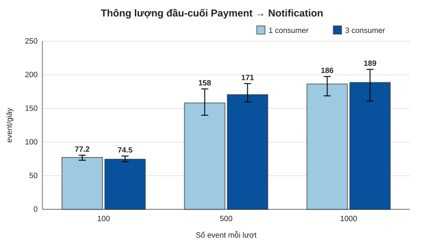
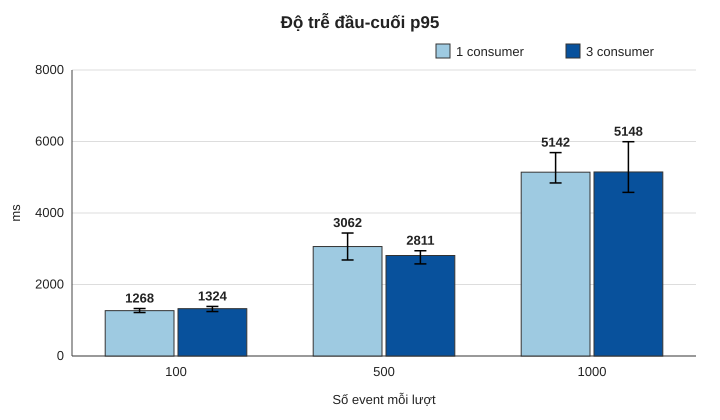

# Thí nghiệm hiệu năng Payment → Notification

## Mục đích

Yêu cầu nghiệm thu: gửi lần lượt 100 / 500 / 1000 sự kiện chuyến hoàn thành (`trip.completed`), đo luồng Payment → Notification xử lý nhanh đến đâu, và so sánh Payment chạy 1 và 3 consumer. Mỗi cấu hình chạy ít nhất 3 lần; kết quả gồm bảng thông lượng (sự kiện/giây), độ trễ p50 / p95 / max, hai biểu đồ và nhận xét.

## Cách chạy lại

Điều kiện:

- Toàn bộ hệ thống đang chạy và healthy: `docker compose -f deploy/docker-compose.yml --env-file .env up -d` (không cần profile `scale`).
- Đã cài thư viện của Trip Service, vì script dùng lại `pg`, `amqplib`, `dotenv` của nó: `npm ci --prefix trip-service`.
- Các queue `payment-service.trip.completed`, `notification-service.payment.succeeded`, `trip-service.payment.*` đang rỗng và outbox của Payment không còn event chờ. Script tự kiểm tra và dừng ngay, chưa thay đổi gì, nếu điều kiện chưa đạt.

Chạy tại thư mục gốc repo:

```powershell
node scripts/perf-payment-notification.js
```

| Tham số | Mặc định | Ý nghĩa |
| --- | --- | --- |
| `--runs` | `3` | Số lượt cho mỗi cấu hình |
| `--sizes` | `100,500,1000` | Số event mỗi lượt |
| `--consumers` | `1,3` | Số consumer của Payment cần so sánh |
| `--warmup` | `200` | Số event của lượt khởi động sau mỗi lần tạo lại Payment (không tính kết quả) |
| `--timeout` | `120` | Số giây tối đa chờ một lượt xử lý xong |
| `--out` | `docs/evidence/perf` | Thư mục ghi kết quả |

Trong lúc chạy, script:

1. Tạm dừng `trip_service`, vì Trip cũng nhận `payment.succeeded`. Với chuyến giả, nó sẽ retry rồi đẩy vào DLQ và làm nhiễu số đo.
2. Tạo lại `payment_service` với `PAYMENT_LISTENER_CONCURRENCY` = 1 rồi 3, qua file phụ `deploy/docker-compose.perf.yml`. Script xác nhận queue có đúng số consumer trước khi đo.
3. Khi xong, lỗi, hoặc bấm Ctrl+C, đưa Payment về cấu hình mặc định (3 consumer), dọn hai queue `trip-service.payment.*` và chạy lại `trip_service`.

Mỗi lần chạy đủ tham số mặc định gửi khoảng 10.000 event với ID ngẫu nhiên. Các payment và thông báo thử được giữ lại trong database, giống các bộ kiểm thử tích hợp khác. Một lần chạy mất khoảng 4 phút.

Kiểm thử đơn vị của script (không cần Docker): `node --test scripts/perf-payment-notification.test.js`.

## Cách đọc số liệu

Mỗi lượt gửi dồn cả lô N event qua AMQP (có publisher confirm), rồi đọc mốc thời gian của từng chuyến trong database:

| Số đo | Cách tính |
| --- | --- |
| Độ trễ đầu-cuối | Lúc thông báo được lưu (`notifications.created_at`) − lúc gửi event |
| p50, p95 | Nearest-rank trên N độ trễ của một lượt |
| max | Độ trễ lớn nhất trong lượt |
| Thông lượng đầu-cuối | N ÷ (thông báo cuối cùng − event đầu tiên được gửi) |
| Chặng Payment | `payments.created_at` − lúc gửi |
| Chờ relay | `outbox_events.published_at` − `payments.created_at` |
| Chặng Notification | `notifications.created_at` − `outbox_events.published_at` |

Lưu ý khi đọc:

- **Độ trễ gồm cả thời gian xếp hàng.** Cả lô được gửi gần như cùng lúc, nên event cuối phải chờ các event trước. Độ trễ không phải thời gian xử lý một event riêng lẻ, và p95 tăng theo kích thước lô.
- **Mốc của từng chặng là xấp xỉ.** `payments.created_at` được ghi lúc lưu payment, trước khi transaction commit. `published_at` được ghi sau khi broker xác nhận đã nhận event. Notification thường đã lưu xong thông báo trước khi Payment nhận được xác nhận, nên chặng Notification ra số âm khoảng 1–2 ms. Con số này có nghĩa là Notification xử lý gần như tức thì, không phải lỗi đo.
- **Đồng hồ được hiệu chỉnh.** Mốc gửi lấy theo đồng hồ máy chạy script; các mốc khác lấy theo đồng hồ container, dùng chung đồng hồ của máy ảo Docker. Trước mỗi lượt, script đo độ lệch giữa hai đồng hồ (5 lần hỏi PostgreSQL, lấy lần có thời gian khứ hồi ngắn nhất). Lần chạy này độ lệch dưới 2 ms và thời gian khứ hồi dưới 1 ms (cột `clockOffsetMs`, `clockRttMs` trong `raw.csv`).

## Kết quả

- Bảng tổng hợp: [results.md](results.md)
- Số liệu từng lượt: [raw.csv](raw.csv)
- Máy và tham số của lần chạy: [environment.txt](environment.txt)





## Nhận xét

1. **Ở chặng Payment, 3 consumer nhanh hơn rõ.** Thông lượng ghi payment tăng khoảng 2,5–2,7 lần (1000 event: 328 → 900 event/s). p95 của chặng Payment giảm hơn một nửa (1000 event: 2949 → 1078 ms).
2. **Tính đầu-cuối thì gần như không đổi.** Thông lượng ở 1000 event là 186 và 189 event/s; p95 là 5142 và 5148 ms. Ở 500 event, 3 consumer tốt hơn khoảng 8% về thông lượng và p95. Ở 100 event, chênh lệch nằm trong mức dao động giữa các lượt.
3. **Nút thắt là outbox relay của Payment.** Relay chạy một luồng, gửi từng event rồi chờ broker xác nhận, mỗi lô 50 event, và quét mỗi 1 giây. Thông lượng đầu-cuối dừng quanh 190 event/s dù Payment ghi được tới 900 event/s. Khi Payment nhanh hơn, event chỉ nằm chờ lâu hơn trong outbox: thời gian chờ relay p50 ở 1000 event tăng từ 1690 lên 2754 ms.
4. **Với lô nhỏ, chu kỳ quét 1 giây quyết định độ trễ.** Ở 100 event, p50 đầu-cuối khoảng 1,1 giây, trong đó phần lớn là thời gian chờ relay (800–1000 ms). Số consumer không ảnh hưởng tới phần này.
5. **Notification không phải nút thắt.** Với 2 consumer mặc định, thông báo được lưu gần như ngay khi event tới.
6. **Muốn tăng thông lượng đầu-cuối thì phải sửa relay, không phải tăng consumer.** Ví dụ: gửi cả lô rồi chờ xác nhận một lần, rút ngắn chu kỳ quét, hoặc chạy nhiều relay song song nhờ `FOR UPDATE SKIP LOCKED`. Đây là đề xuất, chưa được thử trong thí nghiệm này.

Giới hạn của thí nghiệm:

- Mọi service, database và RabbitMQ chạy chung một máy qua Docker Desktop, nên các lượt dao động tới khoảng 30% (ví dụ 3 consumer, 1000 event: 161–208 event/s).
- Notification giữ 2 consumer; chỉ đo nhánh thanh toán thành công.
- Số liệu phản ánh cấu hình mặc định của relay (chu kỳ quét 1 giây, lô 50).
