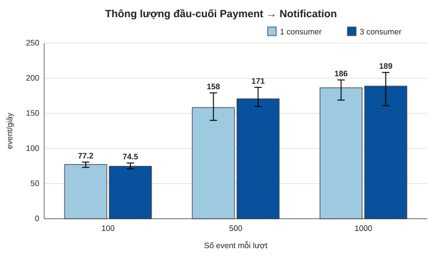
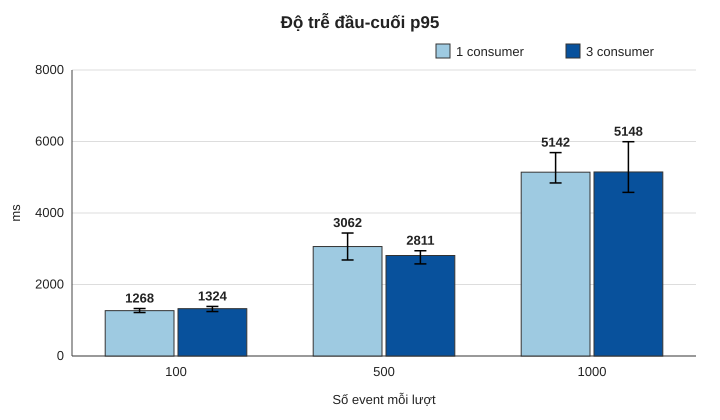

# Kết quả thí nghiệm hiệu năng Payment → Notification

> File này do script sinh tự động (`scripts/perf-payment-notification.js`), không sửa tay.
> Thời điểm chạy: 2026-11-17T01:57:13.941Z. Commit: `56ae835`. Mỗi cấu hình chạy 3 lượt.
> Cách đo và nhận xét: xem [README.md](README.md).

## Đầu-cuối: gửi `trip.completed` → thông báo được lưu

Số ngoài ngoặc là trung bình các lượt; trong ngoặc là khoảng min–max giữa các lượt. Cột max là giá trị lớn nhất của mọi lượt.

| Consumer | Số event | Số lượt | Thông lượng (event/s) | p50 (ms) | p95 (ms) | max (ms) |
| --- | --- | --- | --- | --- | --- | --- |
| 1 | 100 | 3 | 77.2 (73.0–80.5) | 1064 (1014–1121) | 1268 (1216–1328) | 1351 |
| 1 | 500 | 3 | 158.2 (139.9–179.0) | 2081 (1827–2373) | 3062 (2686–3440) | 3549 |
| 1 | 1000 | 3 | 186.3 (168.7–197.4) | 3207 (2941–3542) | 5142 (4840–5689) | 5893 |
| 3 | 100 | 3 | 74.5 (71.0–79.2) | 1132 (1070–1170) | 1324 (1244–1386) | 1405 |
| 3 | 500 | 3 | 170.5 (159.7–186.8) | 1881 (1692–2104) | 2811 (2576–2944) | 3115 |
| 3 | 1000 | 3 | 188.7 (161.0–208.1) | 3319 (2848–3942) | 5148 (4577–5994) | 6193 |

## Theo chặng (trung bình các lượt)

| Consumer | Số event | Payment (event/s) | Payment p50 / p95 (ms) | Chờ relay p50 / p95 (ms) | Notification p50 / p95 (ms) |
| --- | --- | --- | --- | --- | --- |
| 1 | 100 | 205.6 | 247 / 455 | 823 / 839 | -1 / -1 |
| 1 | 500 | 266.8 | 854 / 1812 | 1184 / 1281 | -1 / -1 |
| 1 | 1000 | 328.3 | 1520 / 2949 | 1690 / 2200 | -2 / -1 |
| 3 | 100 | 509.7 | 109 / 190 | 1026 / 1136 | -2 / -1 |
| 3 | 500 | 619.7 | 428 / 762 | 1454 / 2051 | -2 / -1 |
| 3 | 1000 | 900.3 | 567 / 1078 | 2754 / 4073 | -2 / -1 |

## Biểu đồ

