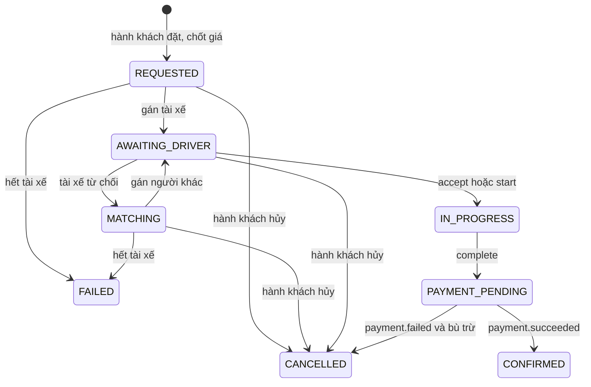

# Phase 3 — Trip và Matching

Nhánh: `feature/trip-matching-phase3`, phát triển từ `origin/develop` tại `af1f978`.

## 4. Mô tả bài toán và yêu cầu

Hành khách cung cấp điểm đón và điểm đến. Trip xác định hành khách từ danh tính
đã xác thực tại Gateway, tính giá và lưu chuyến. Matching tìm tài xế gần nhất
trong bán kính 5 km; Driver giữ tài xế bằng cập nhật nguyên tử để tránh giao
một tài xế cho hai chuyến. Tài xế quyết định nhận hoặc từ chối.

| Yêu cầu | Hành vi và điều kiện nghiệm thu |
| --- | --- |
| Nhận chuyến | Chỉ tài xế được giao, có `ROLE_DRIVER`, nhận từ `AWAITING_DRIVER`; Trip thành `IN_PROGRESS`, Driver thành `ON_TRIP` |
| Từ chối | Giải phóng đúng lượt giữ; Trip về `MATCHING`; mọi tài xế đã thử/từ chối được loại khỏi các lần tìm tiếp theo |
| Hết tài xế | Matching phát `matching.failed`; Trip thành `FAILED`, phát `trip.failed`; Notification gửi `TRIP_FAILED` cho hành khách |
| Tính giá | Tính hoàn toàn từ tọa độ ở server; `estimatedDistance` và `fareAmount` của client không quyết định giá |
| Phân quyền | Chỉ hành khách đặt cho chính mình; khách xem/hủy chuyến của mình; chỉ tài xế hiện được giao được xem/nhận/từ chối/bắt đầu/hoàn thành |
| Hủy trước khi nhận | Cho phép ở `REQUESTED`, `MATCHING`, `AWAITING_DRIVER`; giải phóng lượt giữ, không cho hủy sau khi nhận |
| Nhất quán | Trạng thái, lịch sử và outbox trong một transaction; khóa lạc quan bằng `version`; chống trùng `eventId` và kiểm tra trạng thái nghiệp vụ |

### Quy tắc giá cước

Phiên bản `dynamic-v1` thay `haversine-v1`: giá theo loại xe, km, phút, khung giờ
Việt Nam, cung–cầu, cuối tuần/ngày lễ, thời tiết và khu vực. Mức giá và hệ số
lưu trong `fare_rates`, `pricing_rules`, `pricing_holidays`, `pricing_zones`.

`POST /trips/estimate` cấp `quoteId` hiệu lực mặc định 120 giây. Gửi `quoteId`
khi tạo chuyến để khóa đúng giá đã xem. Giá và breakdown được lưu trong
`trips.pricingSnapshot`; hoàn thành chuyến không sửa giá. Payment thu
đúng `trip.completed.payload.fareAmount`, lấy từ `trips.fare` đã lưu.
Xem [thiết kế, cấu hình và ví dụ giá động](dynamic-pricing.md) để biết công thức,
cache surge và chế độ khi chưa có Google API key.

## 8. Thiết kế thành phần và giao thức

### REST API

Client gọi `http://127.0.0.1:8080` với `Authorization: Bearer <token>`.
Gateway xóa các header danh tính client tự gửi rồi đặt `X-User-Id` và
`X-User-Roles` từ JWT đã xác thực. Trip không tự tin `riderId` trong body.
Header này chỉ được tin trong mạng service; các cổng service trực tiếp và
`/internal/**` phải được giới hạn trong môi trường triển khai tin cậy.
Gateway chặn truy cập `/internal/**` từ client.

| Method và đường dẫn | Danh tính/quyền | Kết quả |
| --- | --- | --- |
| `POST /trips/estimate` | Hành khách | `{quoteId, expiresAt, estimatedDistance, estimatedDuration, fareAmount, breakdown, ...}` |
| `POST /trips` | Hành khách | `201`, chuyến `REQUESTED`, lưu giá server và event |
| `GET /trips/{id}` | Chủ chuyến hoặc tài xế hiện được giao | Chi tiết chuyến, giá và version |
| `POST /trips/{id}/accept` | Tài xế hiện được giao | `AWAITING_DRIVER → IN_PROGRESS` |
| `POST /trips/{id}/start` | Tài xế hiện được giao | Alias tương thích của `accept`; gọi lại khi `IN_PROGRESS` không đổi trạng thái |
| `POST /trips/{id}/reject` | Tài xế hiện được giao | `AWAITING_DRIVER → MATCHING`, giải phóng tài xế |
| `POST /trips/{id}/complete` | Tài xế hiện được giao | `IN_PROGRESS → PAYMENT_PENDING`, phát giá đã lưu |
| `POST /trips/{id}/cancel` | Hành khách chủ chuyến | Trước khi nhận: `CANCELLED`, giải phóng lượt giữ |
| `GET /payments/trips/{id}` | Theo quyền Payment hiện có | Số tiền và kết quả thanh toán |
| `GET /notifications/me` | Người dùng đăng nhập | Thông báo của chính người dùng |

Body của estimate (vẫn chấp nhận để tạo chuyến trực tiếp cho client cũ):

```json
{
  "pickup": { "lat": 10.77, "lng": 106.70 },
  "destination": { "lat": 10.78, "lng": 106.71 },
  "vehicleType": "MOTORCYCLE"
}
```

Sau khi hiển thị báo giá, tạo chuyến bằng `{"quoteId":"<UUID từ estimate>"}`.
Báo giá hết hạn hoặc đổi tọa độ/loại xe trả `409`; yêu cầu báo giá mới.
Gọi lại cùng `quoteId` của cùng khách trả cùng chuyến, không tạo thêm event.

Không cần `riderId`, `fareAmount` hoặc `estimatedDistance`. Để tương thích client
cũ, `riderId` chỉ được chấp nhận khi khớp người đăng nhập; gửi ID người khác bị
`403`. Các trường giá/quãng đường client gửi bị bỏ qua, kể cả lúc complete.
Các thao tác nhận/từ chối/bắt đầu/hoàn thành/hủy không cần body.

Mã lỗi: `400` cho tọa độ/UUID sai, `401` khi thiếu danh tính đăng nhập,
`403` khi sai vai trò/chủ sở hữu/tài xế, `404` khi không có chuyến,
`409` khi sai trạng thái hoặc version đã thay đổi; lỗi hạ tầng trả `503`.
Các request chuyển trạng thái dùng lại `sagaId` của chuyến làm correlation ID.

Driver có các endpoint nội bộ `reserve`, `reject`, `start-trip`, `complete-trip`,
`release`. Trip gửi `{tripId}` ở các thao tác thay đổi tài xế để một lời gọi
đến muộn không tác động lên chuyến khác. Các endpoint cũ không có body vẫn
được giữ cho tương thích; luồng phase3 luôn dùng dạng có `tripId`.

### Sự kiện RabbitMQ

Exchange topic durable: `rideflow.events`; routing key bằng `eventType`.
Envelope: `{eventId, eventType, correlationId, occurredAt, payload}`; ID là UUID,
timestamp UTC. Message persistent, `messageId=eventId`, publisher confirm.

| Event | Nguồn → đích | Payload nghiệp vụ |
| --- | --- | --- |
| `trip.requested` | Trip → Matching | `tripId, riderId, pickup, destination, estimatedDistance, fareAmount` |
| `matching.driver_assigned` | Matching → Trip, Notification | `tripId, riderId, driverId, reservationId, assignedAt` |
| `trip.driver_rejected` | Trip → Matching | `tripId, riderId, driverId, pickup, rejectedAt` |
| `matching.failed` | Matching → Trip | `tripId, riderId, reason=NO_AVAILABLE_DRIVERS, failedAt` |
| `trip.failed` | Trip → Notification | `tripId, riderId, reason=NO_AVAILABLE_DRIVERS, failedAt` |
| `trip.cancelled` | Trip → Matching | `tripId, riderId, driverId` (nullable), `cancelledAt` |
| `trip.completed` | Trip → Payment | `tripId, riderId, driverId, fareAmount, completedAt` |
| `payment.succeeded/failed` | Payment → Trip, Notification | Hợp đồng phase2, `amount` phải khớp giá đã lưu |
| `trip.compensated` | Trip → Notification | Hoàn tác khi thanh toán thất bại |

Mỗi consumer dùng queue `<service>.<eventType>` và DLQ cùng tên thêm `.dlq`,
qua exchange `rideflow.dlx`. Lỗi định dạng vào DLQ ngay; lỗi tạm thời thử tối đa
3 lần, chờ 1s rồi 2s. Hết tài xế là kết quả nghiệp vụ, được ACK sau khi ghi
`matching.failed`, không được để treo ở DLQ như lỗi hạ tầng.

## 13. Cài đặt phần Trip, Matching

### Vòng đời chuyến



`CONFIRMED` là trạng thái kết thúc thành công theo Saga hiện có; không thêm
trạng thái mới hoặc đổi ý nghĩa Payment phase2. Driver trở về `AVAILABLE`
khi nhận kết quả thanh toán/bù trừ.

`trip-service/src/routes.js` thực hiện kiểm tra quyền, ước tính giá, thay đổi
trạng thái và ghi outbox. `saga.js` tiếp nhận assignment, thất bại matching và
kết quả thanh toán. `fare.js` chứa công thức giá độc lập; `auth.js` kiểm tra
vai trò và người được giao.

### Chọn tài xế và tìm lại

`matching-service/src/matching.js` lưu một `matching_requests` duy nhất cho
mỗi `tripId`. Trong transaction chuẩn bị, Matching khóa dòng request bằng
`FOR UPDATE`, lấy danh sách Driver đã sắp xếp theo khoảng cách, loại tất cả
`attemptedDriverIds`, rồi lưu `selectedDriverId` và `reservationId` trước khi
reserve bên Driver. Khi process chết sau reserve, lần thử tiếp sử dụng cùng
ID đã lưu để reserve lũy đẳng.

Reserve thành công: trạng thái `ASSIGNED`, tăng số lần thử, lưu tài xế vào danh
sách đã thử và ghi `matching.driver_assigned`. Reserve trả `404/409`: loại ứng
viên đó, tạo reservation mới và thử người tiếp theo. Lỗi kết nối/5xx được retry
như lỗi hạ tầng, không kết luận hết tài xế. Sau tối đa 100 tranh chấp trong một
lần xử lý, message được retry để tránh vòng lặp vô hạn.

Từ chối chỉ hủy lượt ghép đang `ASSIGNED` và đúng `selectedDriverId`; message
cũ không phá lượt ghép mới. Không còn ứng viên: ghi `FAILED` và `matching.failed`
một lần. Trip kiểm tra chủ chuyến và trạng thái, chuyển `FAILED`, ghi `trip.failed`.
Notification tạo thông báo `TRIP_FAILED` cho đúng `riderId`.

### Hủy và sự kiện đến muộn

Trip chuyển `CANCELLED` rồi gọi Driver reject với đúng `tripId` nếu đã biết tài
xế. `trip.cancelled` bảo đảm Matching cũng kết thúc request và giải phóng tài
xế đã chọn ngay cả khi Trip chưa nhận event gán. Matching tạo dòng `CANCELLED`
ngay cả khi event hủy đến trước `trip.requested` (tombstone); yêu cầu đặt đến
muộn không mở lại quá trình matching.

Trip lưu `rejectedDriverIds` để assignment cũ của người đã từ chối không được
gán lại trong khoảng đang tìm người khác. Assignment đến sau hủy/thất bại
được bỏ qua và nhả đúng lượt giữ. Script tích hợp tạo fixture riêng, gửi hủy
trước rồi mới phát yêu cầu đặt đến muộn để kiểm tra thứ tự này một cách xác định.

### Transactional outbox

Trip và Matching ghi `event_outbox` trong cùng transaction với cập nhật trạng
thái và lịch sử. Worker mỗi giây chọn tối đa 20 dòng chưa gửi bằng
`FOR UPDATE SKIP LOCKED`; publish với confirm rồi mới ghi `published_at`.
Broker mất kết nối thì giữ dòng chưa gửi; reconnect sẽ gửi lại. Crash sau
broker confirm nhưng trước commit có thể phát trùng, nên hệ thống dùng giao
nhận ít nhất một lần và consumer chống trùng, không tuyên bố exactly-once.

Migration bổ sung `trips.rejectedDriverIds` được áp dụng bằng
`ALTER TABLE ... ADD COLUMN IF NOT EXISTS` khi Trip khởi động. Không cần xóa
volume PostgreSQL đang có; schema cho database mới nằm trong `trip_db.sql`.

## 10. Phần nhất quán ở Trip

### Khóa lạc quan

Đọc chuyến lấy snapshot với `version=v`; mọi chuyển trạng thái qua `history`:

```sql
UPDATE trips
SET status = $2, "paymentId" = $3, "driverId" = $4,
    "rejectedDriverIds" = $6,
    version = version + 1, "updatedAt" = CURRENT_TIMESTAMP
WHERE "tripId" = $1 AND version = $5
RETURNING *;
```

Không cập nhật được đúng một dòng thì trả `409` và rollback toàn bộ transaction.
Chỉ sau khi thắng phép so sánh version mới gọi Driver; giao dịch còn giữ khóa
của câu UPDATE cho tới commit/rollback. Vì vậy nhận và hủy đồng thời không thể
cùng thành công. Lịch sử được ghi từ snapshot trước đó và chỉ tồn tại nếu cập
nhật thắng. Response trả dòng mới, gồm version đã tăng.

Driver và Trip dùng database riêng, không có distributed transaction. Các lời
gọi Driver theo `tripId` hỗ trợ retry an toàn khi response bị mất. Nếu HTTP
thành công nhưng transaction Trip chưa commit rồi process chết, cần retry lại
thao tác/event; không thể xem HTTP giữa hai service là một commit nguyên tử.
Lỗi kéo dài được chuyển DLQ và cần vận hành khôi phục/replay.

### Chống trùng và kiểm tra nghiệp vụ

`events.once` thêm `processed_events(event_id PRIMARY KEY)` bằng
`ON CONFLICT DO NOTHING`. Cập nhật trạng thái, history, outbox và dấu đã xử lý
cùng transaction. Handler lỗi thì rollback cả dấu chống trùng, cho phép retry
cùng `eventId` sau khi hạ tầng phục hồi.

Event khác ID nhưng cùng kết quả vẫn được kiểm tra bằng trạng thái:
payment success của chuyến `CONFIRMED` không tạo lịch sử mới; matching failure
không mở lại/đổi chuyến đã hủy hoặc đã có tài xế; repeated complete không phát
thêm `trip.completed`. Mọi quyền được kiểm tra **trước** nhánh xử lý lũy đẳng,
để người khác không thể dùng request lặp lại để đọc hoặc tác động chuyến.

Đối chiếu `riderId`, `driverId` (nếu có) và số tiền khi áp dụng kết quả thanh
toán; số tiền phải bằng `trips.fare`. Các API Driver dạng có `tripId` ngăn
release/complete cũ giải phóng tài xế đang phục vụ chuyến khác.

## Kiểm thử và minh chứng

```powershell
$env:GRADLE_USER_HOME = Join-Path $PWD '.verification\gradle-home'
npm.cmd --prefix trip-service ci
node --test scripts/trip-matching.test.js scripts/trip-matching-phase3.test.js
.\gradlew.bat build
docker compose -f deploy/docker-compose.yml --env-file .env --profile scale up --build -d --wait
node scripts/check-trip-matching-phase3.js
node scripts/check-trip-matching-integration.js
node scripts/check-driver-reject.js
```

Test phase3 kiểm tra giá/giả giá, quyền theo JWT thật tại Gateway (gồm giả
header danh tính), A từ chối rồi B nhận, hết tài xế và thông báo, hủy trước/sau
nhận, message đến muộn/trùng, tranh chấp accept/cancel và hai snapshot PostgreSQL
với cùng version. Các script phase2 cũng tính giá theo route thực tế; kịch bản
payment failure dùng route dài để vượt ngưỡng Payment, không ép giá từ client.

Kết quả thực tế và giới hạn môi trường xem [minh chứng](evidence/phase3/trip-matching-results.md).
Hướng dẫn trình diễn xem [demo](demo-trip-matching-phase3.md).

Nếu ổ chứa Docker thiếu dung lượng, có thể chạy ứng dụng Java/Node thật trên
host, chỉ dùng các image PostgreSQL/RabbitMQ/Redis đã cache và database tạm
trong RAM. Cách này cần build Java và cài dependency cho cả hai service Node:

```powershell
npm.cmd --prefix matching-service ci
node scripts/run-trip-matching-local.js
node scripts/run-trip-matching-local.js --regression-demo
```

Runner dùng project Docker riêng `ride-phase3-local`, không thay volume của
stack chính; tự dừng ứng dụng và xóa hạ tầng tạm khi xong. Database tạm không
giữ dữ liệu sau test; transcript giữ trong `docs/evidence/phase3`, log service
giữ local trong `.verification/phase3-local/`. Các cổng mặc định của stack phải
đang trống. Đây là kiểm thử tích hợp với các service thật, nhưng không đồng
nghĩa đã xác minh thành công việc build/khởi động toàn bộ image Compose.
