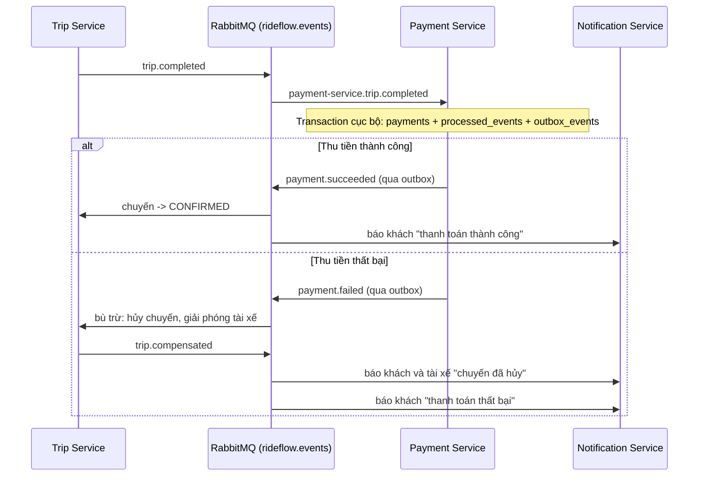

# Saga thanh toán chuyến đi

> Người phụ trách: Thành viên 3 (Payment/Notification). Phần của Trip Service (TV2) được ghi
> rõ ở mục 5 để hai bên triển khai khớp nhau.

## 1. Bài toán

Một chuyến đi hoàn thành kéo theo nhiều thay đổi ở các service khác nhau, mỗi service có
database riêng nên không thể dùng một transaction chung:

| Bước | Service | Thay đổi |
|---|---|---|
| 1 | Trip | Chuyến chuyển sang `COMPLETED`, chờ thanh toán (`PAYMENT_PENDING`) |
| 2 | Payment | Thu tiền khách, tạo bản ghi `payments` |
| 3 | Trip | Chuyến chuyển sang `CONFIRMED` (đã thu tiền) **hoặc** chạy bước bù trừ |
| 4 | Notification | Báo kết quả cho khách và tài xế |

Hệ thống dùng **Saga dạng choreography**: mỗi service xử lý transaction cục bộ của mình rồi
publish event lên exchange `rideflow.events`; service tiếp theo phản ứng với event đó. Không có
service điều phối trung tâm.

## 2. Luồng event

## 3. Bước thanh toán (Payment Service)

Khi nhận `trip.completed`, `PaymentServiceImpl.handleTripCompleted` chạy trong **một
transaction**:

1. **Deduplication theo `eventId`**: nếu `eventId` đã có trong `processed_events` thì bỏ qua
   (RabbitMQ giao lại cùng message).
2. **Idempotency theo `tripId`**: `payments.idempotency_key = tripId` có ràng buộc `UNIQUE`.
   Nếu chuyến đã có payment thì không thu tiền lần hai, chỉ ghi nhận event là đã xử lý.
3. **Trừ tiền**: chuyến trả bằng ngân hàng (`paymentMethod = BANK`, mặc định) trừ khoản đã khoá
   lúc đặt chuyến trong ngân hàng ảo; không còn khoản khoá thì trừ trực tiếp, số dư không đủ thì
   thất bại với lý do `INSUFFICIENT_FUNDS`. Chuyến tiền mặt (`CASH`) tạo payment `PENDING` và chờ
   tài xế xác nhận (mục 3.1).
4. **Ghi kết quả**: lưu payment (`SUCCESS`/`FAILED`), dòng `processed_events` và event kết quả
   (`payment.succeeded`/`payment.failed`) vào `outbox_events`.

`OutboxRelay` chạy mỗi giây, đọc các event chưa publish (`FOR UPDATE SKIP LOCKED`), publish lên
RabbitMQ, chờ broker xác nhận (publisher confirm) rồi mới đánh dấu đã publish.

Nhờ outbox, payment và event kết quả luôn cùng được lưu hoặc cùng bị hủy: không có trường hợp
đã thu tiền mà không báo cho Trip Service, kể cả khi RabbitMQ chết đúng lúc đó.

### 3.1 Ngân hàng ảo, khoá tiền khi đặt chuyến và tiền mặt

Mỗi hành khách có một tài khoản ngân hàng ảo trong `payment_db` (`bank_accounts`, `fund_holds`,
`bank_transactions`); khách mới có sẵn 500.000 VND, tài khoản mẫu `passenger1` 1.000.000 VND,
`passenger2` 30.000 VND.

- **Khi đặt chuyến** (`trip.requested`): Payment khoá đúng số tiền của chuyến. Dòng tài khoản được
  khoá `FOR UPDATE` nên nhiều chuyến đặt đồng thời không vượt số dư khả dụng (số dư − tổng đang
  khoá); `UNIQUE(trip_id)` chặn khoá hai lần. Kết quả phát qua outbox: `payment.authorized` hoặc
  `payment.authorization_failed` (`INSUFFICIENT_FUNDS`).
- **Chuyến hủy hoặc thất bại** (`trip.cancelled`, `trip.failed`): mở khoá. Event hủy tới trước
  `trip.requested` thì chuyến được ghi vào `closed_trips` và không bị khoá về sau.
- **Kết thúc chuyến**: trừ khoản đã khoá (mục 3). Khoản chưa trừ hay mở sau 2 giờ được tác vụ định
  kỳ tự mở.
- **Tiền mặt**: không khoá; tài xế gọi `POST /payments/trips/{tripId}/cash-confirm` sau khi nhận
  tiền thì payment chuyển `SUCCESS` và phát `payment.succeeded`.

API cho khách (qua Gateway): `GET /payments/bank/me`, `GET /payments/bank/me/transactions`,
`POST /payments/bank/me/topup`. Hợp đồng event mới ở mục 2.8 của `docs/event-schema.md`.

## 4. Xử lý lỗi

| Tình huống | Cơ chế | Kết quả |
|---|---|---|
| RabbitMQ giao trùng message | `processed_events` (eventId) | Chỉ xử lý một lần |
| Trip publish lại `trip.completed` với eventId mới | `UNIQUE(idempotency_key)` | Không thu tiền lần hai |
| Nhiều consumer xử lý cùng chuyến song song | `UNIQUE(idempotency_key)` + retry | Bên thua retry và rơi vào nhánh idempotency |
| Cổng thanh toán lỗi tạm thời | Retry tại listener: 3 lần, backoff 1s, 2s | Thành công ở lần thử sau |
| Lỗi kéo dài hết lượt retry | Dead-letter queue `payment-service.trip.completed.dlq` | Không mất message, replay khi hết lỗi |
| Message sai định dạng | `InvalidEventException` không retry | Vào DLQ ngay |
| Payment Service dừng | Queue durable, message persistent | Message chờ trong queue, xử lý khi service chạy lại |
| RabbitMQ chết khi đang publish kết quả | Outbox + publisher confirm | Event nằm trong `outbox_events`, gửi khi broker hồi phục |
| Notification Service dừng | Queue riêng của Notification | Thanh toán vẫn chạy, thông báo được gửi bù |

Retry và DLQ cấu hình chung cho mọi consumer (xem `docs/event-schema.md`, mục 1.6).

## 5. Phần Trip Service cần làm (TV2)

1. **Publish `trip.completed`** khi chuyến kết thúc, theo schema mục 2.1 của
   `docs/event-schema.md`. Payment nhận cả `riderId` lẫn `passengerId`.
2. **Consume `payment.succeeded`**: chuyển chuyến sang `CONFIRMED`, lưu `paymentId`.
3. **Consume `payment.failed`** (bước bù trừ):
   - chuyển chuyến sang `CANCELLED` (hoặc `FAILED`), ghi `reason` vào `trip_status_history`;
   - gọi Driver Service `POST /internal/drivers/{driverId}/release` để giải phóng tài xế;
   - publish `trip.compensated` (schema mục 2.5), **copy `correlationId`** từ `payment.failed`.
4. Cả hai consumer phải **idempotent**: lưu `eventId` đã xử lý, bỏ qua message trùng. Bước bù
   trừ chạy lại lần hai không được gọi release hai lần (kiểm tra trạng thái chuyến trước).
5. Queue đặt tên `trip-service.payment.succeeded`, `trip-service.payment.failed`, khai báo
   dead-letter như mục 1.6 của event-schema.

## 6. Kiểm thử

`tests/phase2-payment-notification.ps1` chạy các kịch bản ở mục 4 bằng event giả lập
(`scripts/publish-event.ps1`) và ghi kết quả vào `docs/evidence/phase2/`. Khi Trip Service
publish event thật, chạy lại luồng đầy đủ: đặt chuyến, hoàn thành chuyến, kiểm tra payment,
trạng thái chuyến và thông báo.
